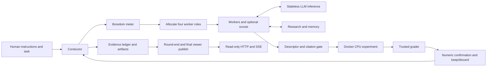
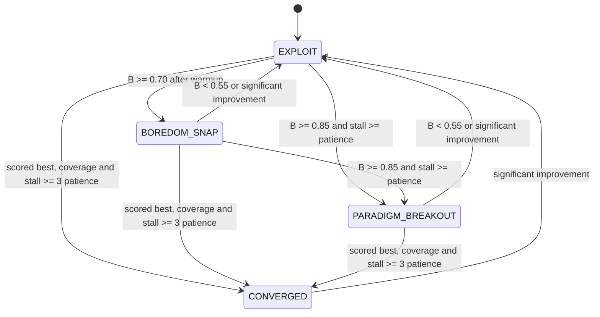
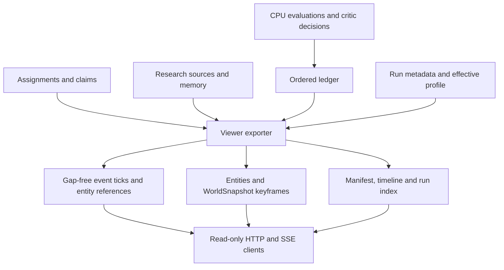

# Artificial Scientist Swarms

Artificial Scientist Swarms investigates a practical question: when should an automated
researcher stop refining one approach and try another? Four worker slots propose small
program changes, call an LLM through Tinker, OpenAI or an offline fake adapter, run
experiments on CPU in Docker, and retain only measured improvements. A reproducible **boredom meter** shifts effort from local refinement toward
different methods when experiments become repetitive and progress stalls. Judges can
follow a run from its hypotheses through evaluation, decisions, memory and read-only replay.



The human edits [program.md](program.md); agents may edit only the task's declared
candidate file, not the grader or research rules. The objective is a **score, lower is
better**. The running backend described here has source baseline `1ed1426`; the separate
Ig Nobel community is described at main revision `be658b6`. Extensions that are not yet
merged into those implementations are explicitly identified.

Start with [why boredom](#why-boredom), [agent types](#types-of-agents),
[the loop](#orchestration-loop), or [the meter](#boredom-meter).
Exact implementation locations live in the [backend reference](docs/backend.md).

## Why boredom

A researcher can remain busy while learning little. Repeating a familiar method may be
cheap and reliable, but small parameter changes are not always the best next experiment.
The design uses boredom as a name for the signal that this pattern should be interrupted,
not as a claim that software has feelings.

Psychology provides several useful distinctions. Eastwood and colleagues describe boredom
in terms of unsuccessful attentional engagement in satisfying activity [1]. Westgate and
Wilson's Meaning and Attentional Components model separates difficulty engaging attention
from a mismatch between an activity and valued goals; both understimulation and
overstimulation can matter [2]. These accounts caution against equating boredom with
simple inactivity or failure.

Bench and Lench argue that boredom can motivate pursuit of alternative goals [3].
Elpidorou likewise describes a regulatory role for boredom in redirecting activity [4].
For this backend, the useful analogy is a **switch signal**: not “the experiment went
badly,” but “the current pattern of experiments may no longer be worth repeating.”
This sits within the wider exploration–exploitation problem reviewed by Cohen, McClure
and Yu [5]. It is not evidence that a particular threshold is optimal.

| Psychological construct | Engineering counterpart | Important difference |
| --- | --- | --- |
| Unsuccessful attention/engagement and repetitive activity [1, 2] | Low descriptor novelty raises B | A method label is a proxy for repetition, not a measure of attention |
| Lack of meaningful, goal-congruent engagement [2] | Stagnation tracks attempts without meaningful score improvement | A benchmark objective is not a person's sense of meaning |
| Boredom as motivation to change activity [3, 4] | Higher B reallocates slots toward divergent work and different mechanisms | The policy changes search instructions, not subjective motivation |
| Distinct confusion, frustration and boredom states during learning [6] | Unmerged Ig Nobel PR #7 reports frustration separately from B and requests design review | This is a design analogy, not a reproduction of human affect dynamics |

D'Mello and Graesser study transitions among engagement, confusion, frustration and
boredom during complex learning [6]. That supports treating these as distinct concepts,
rather than calling every failed experiment boredom. The CPU meter reports frustration
separately, while its overload term still includes failure/repetition; the proposed
Ig Nobel revision makes a stronger separation.

The computational ingredients have different sources. Nearest-neighbor sparseness follows
the novelty-search idea of Lehman and Stanley [7], but this system **does not abandon its
objective**: novelty steers proposals, while benchmark scores decide retention. The
reported diversity statistic is the complement of Simpson concentration [8].

**B is an engineering operationalization inspired by these ideas, not a model of affect
and not psychologically validated.** The literature motivates distinctions and questions;
it does not supply the implemented weights, thresholds, causal efficacy or scientific
validity of the swarm.

## Types of agents

Agents have distinct responsibilities and share the inference adapters. Scouts are additional
assignments on existing worker slots, so they do not create extra candidate slots.
Conductor and gate are deterministic control components; the critic's explanation cannot
override the numeric acceptance rule.

| Type / role | Reads | Writes / action | LLM prompt |
| --- | --- | --- | --- |
| Conductor | Task/profile, ledger, all status and evaluation results | Assignments, suggested/reserved cells, worktrees, outcomes, Git history, memory, run metadata and round-end/final viewer publishes | None; `swarm.py` calls role prompts below |
| Scout | Brief, regime, memory, research query results/extracts | Queries, source selection, grounded implementation leads and lead memory | `prompts/scout_query.md`, `scout_pick.md`, `scout_lead.md` |
| Worker: exploit | Current best source, protocol, task inputs, status, recalled results/leads/claims | Focused local patch, descriptor, claim, predicted delta and research trailers | `prompts/worker_propose.md`; `worker_repair.md` on rejection |
| Worker: divergent | Same inputs plus suggested/assigned under-visited cells | Alternative mechanism/method patch, source-backed claim; conductor-cell repair if needed | Same worker prompts, role/regime-dependent instructions |
| Critic | Provisional claim, both measured scores, previous best, recent basin history | Verdict/explanation in critic.tsv and audit event; numeric predicate remains authoritative | `prompts/critic.md`, `critic_novelty.md`; identical in A/B |
| Gate | Commit trailers, descriptor/profile, ledger, research IDs | Pass/reasons and distance/citation audit in boredom_log.jsonl | None; `boredom.py:run_gate`, `meter.py:gate` |
| Ig Nobel researcher (main) | Private library, ideas/studies, peer conversation and instruments | Proposals/refinements, study code, abstracts and lessons in memory/events | Inline `ignobel/agents.py`: `propose`, `refine`, `talk`, `write_study_code`, `write_abstract`, `write_lesson`; not root prompts/ |
| Ig Nobel statistician (main) | Same agent interface; statistician specialization in AgentSpec | Research using statistical instruments; #7 adds peer design review | Same inline agent methods; #7 adds review/refine advice |
| Ig Nobel committee (main) | Finished study abstracts after the run | Independent judge scores/reasons | Inline `ignobel/committee.py` judge A/B prompts; never a round controller |
| Ig Nobel mother / daughter (#8, **not yet merged**) | Mother: meeting + daughter histories; daughter: private data/library | Mother founds/spawns labs, no studies; daughter acts as researcher | Inline `families.py` talk/propose_daughter and `agents.py`; not root prompts/ |

All root role prompts share the common instructions and human protocol. The viewer API is
a separate artifact reader, not an agent and not a controller of the research process.

Implementation: `swarm.allocate_roles`, `llm.render_prompt` and the role templates in `prompts/`.

## Orchestration loop

A run starts from one Git revision and allocates four worktrees at each round's common
base. Calls and evaluations are **sequential** in this implementation; four slots do not
mean four concurrent experiments.

1. Evaluate the starting program and load the task's descriptor vocabulary and meter profile.
2. Recompute shared and worker-scoped meter status from the ledger. Stop if converged;
   otherwise assign exploit, divergent and scout responsibilities, with suggested cells.
3. Have scouts recall previous findings, retrieve prior art and turn useful sources into
   implementation leads.
4. Have workers recall outcomes and current claims, propose focused edits and commit them
   with descriptors and research references.
5. Check each proposal at the gate. A worker has up to three bounded attempts: initial
   proposal, repair, and possible conductor-assigned descriptor-cell work. Previously scored
   deterministic editable-file blobs become duplicate attempts without evaluation.
6. Deduplicate identical passing blobs within the round, evaluate unique programs inside
   Docker and identify the best provisional improvement.
7. Judge prior-art novelty for candidates with hits (audit only), then apply numeric
   confirmation: deterministic tasks reuse the first score; other tasks run a second
   evaluation. Obtain the same critic explanation in A and B. Keep only a confirmed
   improvement and advance the conductor to it.
8. Record outcomes and memories, update tabular/status artifacts, commit the research
   artifacts, tag attempts, optionally push, and publish the round's viewer state.
   On exit, publish a final finished or stopped state.

```mermaid
sequenceDiagram
  participant C as Conductor
  participant M as Meter and memory
  participant W as Scouts and workers
  participant G as Gate
  participant E as CPU sandbox and grader
  participant K as Confirmation and critic
  participant V as Viewer publisher
  C->>E: Evaluate starting program
  loop Each round, until budget or convergence
    C->>M: Fold ledger; stop if converged, otherwise allocate roles
    C->>W: Assign four candidate slots and optional scouts
    W->>M: Recall findings and record grounded claims
    W->>G: Commit candidate with descriptor and references
    G-->>W: Pass or bounded repair/reassignment
    C->>E: Evaluate unique passing blobs
    E-->>C: Score or crash
    opt Provisional improvement
      C->>K: Reuse deterministic score or evaluate again; apply rule
      K-->>C: Numeric decision and arm-independent explanation
    end
    C->>M: Record keep/discard/crash/duplicate and memories
    C->>C: Commit artifacts, tag attempts, optionally push
    C->>V: Publish running state unless disabled
  end
  C->>V: Publish finished/stopped state unless disabled
```

All three current CPU tasks declare deterministic evaluation: confirmation reuses the first
score and records `critic_rerun="skipped (deterministic)"`. Other tasks repeat evaluation
without independently changing seeds. At a round boundary, CONVERGED stops further work,
writes converged.json and marks run.json/manifest converged=true. A known-optimum score
also stops any arm, including when reached in the final round. Currently only Hadamard
sets known_optimum_loss=0; the check accepts best score at most target plus 1e-9. Round budgets range from
1 to 50. The gate verifies
declared novelty and citation requirements, not scientific originality.
`--no-push` suppresses remote pushes, not local branches, commits or tags; fake mode also
forces no-push. Viewer publication failures are logged without aborting the experiment.

Implementation: `swarm._orchestrate`, `swarm.orchestrate` and `swarm.publish_viewer_state`.

## Boredom meter

The CPU meter combines repetition, stagnation and an overload proxy. High B asks the
conductor to change how it searches; low B favors focused work. Its inputs are only the
ordered ledger prefix and a domain profile: no LLM, embedding, clock, randomness or
external service participates in calculating B.

Let $`\operatorname{clip}(x)=\min(1,\max(0,x))`$ and let $`\operatorname{r}_q`$ mean rounding
to $`q`$ decimal places. For novelty $`N_t`$, stagnation $`S_t`$ and overload $`O_t`$:

```math
B_t=\operatorname{r}_9\!\left(
 \operatorname{clip}\!\left(w_1(1-N_t)+w_2S_t+w_3O_t\right)\right),
\qquad (w_1,w_2,w_3)=(0.45,0.45,0.10).
```

The weights and thresholds below are configured defaults, not estimates from psychology.
The meter reports most metrics to six decimals, but regime comparisons use nine-decimal B.
The profile's direction determines improvement; all three CPU tasks minimize score.

### Describing how experiments differ

A descriptor is a path through a declared vocabulary, such as mechanism then method, plus
numeric parameters. A different top-level mechanism is farther away than a different
method within the same mechanism. Distance is **not** a weighted sum over mismatched
levels: the first differing level decides it.

Let the ordered levels be $`\ell_1,\ldots,\ell_L`$ with weights $`\lambda_i`$.
If no level differs, compare parameters with residual weight $`\rho`$:

```math
d(a,b)=
\begin{cases}
 \lambda_j,&j=\min\{i:a_{\ell_i}\ne b_{\ell_i}\},\\
 \operatorname{r}_9\!\left(\rho\,\delta(a_{\rm params},b_{\rm params})\right),
   &a_{\ell_i}=b_{\ell_i}\ \text{for all }i.
\end{cases}
\qquad \rho=\text{params\_weight}\ \text{or }\lambda_L/2.
```

The CPU profiles use level weights $`(1,0.5)`$, residual weight $`0.25`$ and a ratio scale
with ratio $`4`$. In general, let $`P`$ be the union of parameter names. A missing value on
either side contributes distance one; two empty parameter maps have distance zero.

```math
\delta(a,b)=
\begin{cases}
0,&P=\varnothing,\\
|P|^{-1}\displaystyle\sum_{p\in P}\Delta_p(a_p,b_p),&P\ne\varnothing.
\end{cases}
\quad
\Delta_p(x,y)=
\begin{cases}
1,&p\text{ is absent from either descriptor},\\
\min\!\left(\dfrac{|\ln(\hat x/\hat y)|}{\ln r_p},1\right),&\text{ratio scale},\\
\min\!\left(\dfrac{|f_p(x)-f_p(y)|}{h_p},1\right),&\text{linear or log scale}.
\end{cases}
```

For ratio scales, $`\hat x=\max(|x|,10^{-12})`$ and similarly for $`\hat y`$.
For linear scales, $`f_p(v)=v`$; for log scales,
$`f_p(v)=\log_{10}(\max(v,10^{-300}))`$. Given configured bounds $`l_p,u_p`$,
$`h_p=f_p(u_p)-f_p(l_p)`$, replaced by $`1`$ if that difference is zero.
Descriptor validation requires declared parameters with finite numeric values. Two-level
profiles also accept `other/<slug>`: an ASCII lowercase identifier of 2–40 characters,
starting with a letter and containing only letters, digits or underscores. New cells are
logged in vocab_extensions.jsonl and included in subsequent prompt vocabularies without
changing the profile or its hash.

### Novelty, progress and repeated failures

Index eligible attempts in ledger order. These include baseline and candidate rows with
keep/discard/crash/duplicate status, but exclude critic rows and rejected proposals.
Rejections remain in audit logs. Duplicates enter the archive and scoped windows, increment
stagnation/stall and count as trivial even when their declared descriptor is distant. Let $`A_{t-1}`$ be all eligible
descriptors **preceding** attempt $`t`$. Its sparseness $`\nu_t`$ is the average distance
to the nearest $`m_t`$ archive members [7]:

```math
m_t=\min(\text{knn},|A_{t-1}|),\qquad
\nu_t=
\begin{cases}
1,&A_{t-1}=\varnothing,\\
\dfrac{1}{m_t}\displaystyle\sum_{a\in\operatorname{NN}_{m_t}(d_t,A_{t-1})}d(d_t,a),
 &\text{otherwise}.
\end{cases}
\qquad
N_t=\frac{1}{|W_t|}\sum_{i\in W_t}\nu_i.
```

$`W_t`$ contains the last $`k`$ eligible attempts in the requested scope. An empty window
returns $`N_t=1`$. Neighbors may include failed and discarded attempts: repeating something
that failed is still repetition.

A frontier-eligible score is finite, numeric and has a configured frontier status:
all CPU profiles use **keep only**. Discarded, crashed and duplicate attempts cannot move
the best, even if they carry a numeric score. Let $`h_{t-1}`$ be the last significant best:

```math
I_t=\mathbf{1}\!\left[
 y_t\text{ is frontier-eligible}\ \land\
 (h_{t-1}\text{ is unset}\ \lor\ y_t<h_{t-1}-\epsilon)\right],
\qquad h_t=\begin{cases}y_t,&I_t=1,\\h_{t-1},&I_t=0.\end{cases}

```

For a maximizing profile, reverse the inequality and add the margin. The CPU profiles
use patience_unit=round: stagnation and frontier stall count **distinct round keys since
the last significant improvement**, not worker attempts. Let $`j_t`$ be the most recent
index with $`I_{j_t}=1`$, or zero if none. An integer round is its key; an event without
one has its own seq key. With no significant best, the excluded key below is unset:

```math
K_i=
\begin{cases}
(\mathrm{round},r_i),&r_i\text{ is an integer},\\
(\mathrm{seq},i),&\text{otherwise},
\end{cases}
\quad
U_t=\{K_i:j_t<i\le t,\ K_i\ne K_{j_t}\},
\qquad
s_t=F_t=|U_t|,\qquad S_t=\min(s_t/p,1).

```

At a significant improvement all keys reset. Later attempts in that same round do not
increment the counter; many non-improving attempts in another round add only one key.
For worker-scoped stagnation, restrict U to that worker's attempts; F remains shared.
Novelty, failure, triviality and diversity windows still contain the last k **attempts**.
The raw best score still records any strict eligible improvement, but in round mode a
sub-epsilon improvement does not reset F.

Omitting patience_unit preserves attempt-mode behavior and historical profile hashes.
Then s increments for each non-significant attempt, while F independently resets on
any strict raw-best improvement. Both counters start at zero.

```math
f_t=\frac{\sum_{i\in W_t}\mathbf{1}[\text{fail status}_i]}{|W_t|},
\quad
q_t=\frac{\sum_{i\in W_t}\mathbf{1}[\min_{a\in A_{i-1}}d(d_i,a)<0.05
 \ \lor\ \mathrm{status}_i=\mathrm{duplicate}]}{|W_t|},
\qquad O_t=\max(f_t,q_t).

```

An empty archive gives nearest distance one; explicit duplicate status still makes the
attempt trivial. Empty windows give rates zero. CPU fail status is crash. Frustration
is the **shared** crash fraction in the last k global attempts, even in worker status:

```math
\mathrm{frustration}_t=
\begin{cases}
0,&|G_t|=0,\\
|G_t|^{-1}\displaystyle\sum_{i\in G_t}\mathbf{1}[\mathrm{status}_i=\mathrm{crash}],
 &|G_t|>0,
\end{cases}
\quad G_t=\text{last }k\text{ global eligible attempts}.

```

Frustration is diagnostic, not an additional B term or a policy threshold. Failures
already contribute through O; reporting frustration separately does not remove that
contribution. This differs from the unmerged Ig Nobel meter described below.

For top-level mechanism counts $`n_c`$ within the same window, the reported diversity
is the complement of Simpson concentration [8]:

```math
D_t=
\begin{cases}
0,&|W_t|=0,\\
1-\displaystyle\sum_c\left(\frac{n_c}{|W_t|}\right)^2,&|W_t|>0.
\end{cases}
```

Diversity is diagnostic; **it does not add a fourth term to B**.

### Regimes, hysteresis and scope

The regime selects the kind of search to attempt next. The following cases are evaluated
**top to bottom**, using default thresholds. Let $`R_{t-1}`$ be the previous regime,
$`p=\text{patience}`$, $`n_t=|A_t|`$, and $`C_t`$ mean that all required top-level mechanisms
have been covered. Abbreviate EXPLOIT, BOREDOM_SNAP, PARADIGM_BREAKOUT and CONVERGED as
E, S, P and C:

```math
R_t=
\begin{cases}
\mathrm{E},&I_t=1,\\
\mathrm{C},&R_{t-1}=\mathrm{C},\\
\mathrm{C},&\text{scored best exists}\ \land\ F_t\ge3p\ \land\ C_t,\\
\mathrm{E},&n_t<3,\\
\mathrm{P},&(B_t\ge0.85\land F_t\ge p)
 \ \lor\ (R_{t-1}=\mathrm{P}\land B_t\ge0.55),\\
\mathrm{S},&B_t\ge0.70
 \ \lor\ (R_{t-1}=\mathrm{S}\land B_t\ge0.55),\\
\mathrm{E},&\text{otherwise}.
\end{cases}
```

This is hysteresis, not a timed cooldown: a snap or breakout persists down to the exit
threshold $`0.55`$. A significant improvement resets even CONVERGED. Convergence is a
coverage-and-stall heuristic, not proof of an optimum; required mechanisms default to
all vocabulary mechanisms, including baseline. A finite frontier-eligible scored best is required before convergence. The warmup is min_attempts=3.



The swarm uses all eligible attempts for its windows. Each worker uses its own attempts
for novelty, failure, triviality and diversity windows, but compares novelty against the
**shared** preceding archive. A global significant improvement resets every worker's
streak/key set; otherwise only the acting worker adds an attempt or eligible round key.
Frontier stall and archive size remain global, while coverage uses the requested scope. Worker-scoped regimes are
folded through the shared event sequence. Global regime drives allocation, and workers
with per-agent $`B\ge0.70`$ receive priority for divergent/scout assignments.
Empty swarm status is B=0, N=1 and EXPLOIT.

| CPU profile | $`\epsilon`$ | $`k`$ | knn | patience |
| --- | --- | --- | --- | --- |
| hadamard19 | 0.005 | 5 | 3 | 3 rounds |
| bixbench_mini | 0.03 | 5 | 3 | 3 rounds |
| playworld_mini | 0.005 | 5 | 3 | 3 rounds |

Profiles also specify the vocabulary, parameter scales, direction and regime instructions.
None sets an explicit acceptance margin, weights or regime thresholds: margin falls back to
epsilon and weights/thresholds use the defaults above. All three set attempt statuses to
keep/discard/crash/duplicate, frontier statuses to keep and trivial statuses to duplicate;
only crash counts as failure. Version-3 CPU profiles use patience_unit=round and a stuck
rule with window=3, min_fails=2 and depth=2.

### Stuck cells

Stuckness is independent of B. For each depth-2 mechanism/method cell c, take its last
three eligible attempts (or fewer if fewer exist):

```math
\mathrm{stuck}(c)\iff
\sum_{i\in H_c}\mathbf{1}[\mathrm{status}_i=\mathrm{crash}]\ge2,
\qquad H_c=\text{last up to 3 attempts in cell }c.

```

Two crashes are enough without waiting for three attempts. Discards and duplicates are
not crashes. Suggestions rank non-stuck cells first, then visits, failures and cell name;
children of a stuck prefix are also marked. The meter gate rejects a stuck cell regardless
of regime or exploit role. Arm A disables that meter gate; deterministic blob deduplication
and ordinary citation checks remain shared.

### Gate and acceptance rules

Outside EXPLOIT and CONVERGED, a proposed descriptor $`d`$ must satisfy:

```math
\min_{a\in A_{\rm recent}}d(d,a)\ge0.35
 \quad(\text{unless the worker role is exploit}),\qquad
\min_{a\in A_{\rm failed/discarded}}d(d,a)\ge0.25.
```

An empty comparison set imposes no restriction. Recent means the last $`k`$ shared eligible
attempts. BREAKOUT also requires a top-level mechanism absent from those attempts.
The standalone gate in CONVERGED permits only a descriptor at distance zero from the
best descriptor; the conductor instead stops before assigning more work:

```math
R=\mathrm{P}\ \Longrightarrow\
 d_{\ell_1}\notin\{a_{\ell_1}:a\in A_{\rm recent}\},\qquad
R=\mathrm{C}\ \Longrightarrow\
 \text{best descriptor exists}\ \land\ d(d,d_{\rm best})=0.
```

Before descriptor/citation checks, deterministic tasks compare the editable-file Git blob
against score_cache.json. A cache hit logs a failed gate with duplicate_of and the cached
score, then records a duplicate ledger attempt without repair or evaluation. Same-round
deduplication evaluates the first occurrence and copies its successful score to later ones.
Baseline and successful evaluations populate this per-run cache; descriptor labels do not
determine code identity. Fake assigned-cell work rejects unbuildable cells instead of
substituting a different method.

Citation checks are additional to descriptor checks. Arm A disables meter gating but still
uses deterministic blob deduplication;
turning Exa off removes prior-art requirements. These checks operate on declared
descriptors and logged source IDs, not an independent semantic assessment of the code.

Let $`y_\star`$ be the previous best score and $`y_1,y_2`$ the first and confirmation scores.
Only the best provisional candidate is confirmed:

```math
m=
\begin{cases}
\text{accept\_margin},&\text{if explicitly configured},\\
\epsilon,&\text{otherwise},
\end{cases}
\qquad
\text{provisional}\iff y_1<y_\star-m,\qquad
\text{keep}\iff\text{second status is ok}\ \land\
 y_2\text{ exists}\ \land\ \frac{y_1+y_2}{2}<y_\star-m.
```

For deterministic tasks, set $`y_2=y_1`$ with confirmation status ok and record the skipped
rerun. Otherwise $`y_2`$ comes from a second evaluation. This is a numeric acceptance guard,
not a statistical significance test or independent replication for deterministic tasks.
Both A and B use this predicate and the same critic and prior-art novelty judgement.
Critic prompts contain no meter state. Novelty judgements are logged, not fed to B or
used to override numeric acceptance.

### Ig Nobel: a different private meter

The separate main backend studies ideas and simulated experiments rather than editable
benchmark programs. Its private meter uses semantic similarity, predictable outcomes
and study failures; it is **not** the CPU formula:

```math
B_{\rm main}=\operatorname{r}_4\!\left(
 \operatorname{clip}(0.5\,\mathrm{similarity}
                   +0.5\,\mathrm{unsurprise}-0.5\,\mathrm{failure})\right).
```

Similarity is the clipped mean cosine of the newest embedded idea against up to five
preceding embedded ideas, or zero with fewer than two. Unsurprise averages $`1-g`$ across
the last five replicated studies, or zero if none. Failure is the fraction of the last
five studies that crashed or did not replicate, or zero if none. For predicted effect $`u`$
and actual effect $`v`$:

```math
g(u,v)=
\begin{cases}
1,&\text{actual effect/direction missing or direction disagrees},\\
0,&|u|+|v|=0\ \text{and directions agree},\\
\min\!\left(\dfrac{\big||u|-|v|\big|}{|u|+|v|},1\right),&\text{otherwise}.
\end{cases}
```

Main configures snap at $`0.50`$, overriding the policy function's default $`0.70`$.
It does not implement the multi-regime cooldown policy below.

**PR #7, not yet merged**, replaces that meter with:

```math
B_7=\operatorname{r}_4\!\left(
 \operatorname{clip}(0.30\,r+0.25\,e+0.20\,u+0.25\,s)\right),
\qquad
r=\operatorname{clip}\!\left(\frac{\mathrm{similarity}-\mu_0}{3\sigma_0}\right),
\quad
e=\operatorname{clip}(1-\mathrm{external\ novelty}),
\quad
s=\min\!\left(1,\frac{\max(0,\mathrm{round}-\mathrm{lastProgressRound})}{3}\right).
```

Here $`u`$ is unsurprise as above. The baseline mean and standard deviation come from the
round-0 idea against the agent's own seeded library. Missing baselines use $`(0,1)`$ and
zero standard deviation becomes one. Similarity considers up to five embedded ideas
since exploration; fewer than two makes $`r=0`$. Missing external novelty gives $`e=0`$.
Progress means a replicated study in a new descriptor cell or with gap at least $`0.5`$.
Components are reported to four decimals; B uses their unrounded values.

Frustration is reported separately and is **excluded** from $`B_7`$:

```math
\mathrm{frustration}=
\frac{\#\{\text{failed or unreplicated studies among the last five}\}}
     {\#\{\text{studies among the last five}\}},
\qquad
\mathrm{frustration}\ge0.6\ \Longrightarrow\ \text{design review before further work}.
```

An empty study window gives zero frustration. The policy prioritizes convergence,
frustration, pending breakout, cooldown and then snap. It requests review, using a
statistician when available. Snap requires two consecutive rounds with
$`B\ge0.50+j`$, where seeded per-agent jitter $`j`$ is uniform in $`[-0.05,0.05]`$ and rounded
to four decimals. Exploration resets similarity history and begins a two-round cooldown.
A pending breakout at elapsed rounds at least two and stall at least $`0.8`$ is checked
before the cooldown condition (elapsed at most two). Convergence requires the current
idea to have a study, the last two studies to have replicated with gaps at most $`0.2`$,
and external familiarity at most $`0.5`$; the agent replicates once more and then holds.

PR #7 also adds a **yoked_random** control. After validating a paired full run's seed
and roster size, it randomly chooses the same number of agents to explore in each round,
counting breakouts as well as snaps. It matches frequency, not identical ideas or cost.

**PR #8, not yet merged**, instead adds mother departments and daughter labs, private
generated data and chance encounters. It is based on PR #6 rather than PR #7. A mother
starts with two daughters by default and may spawn while mean daughter B is at least
$`0.40`$, with a two-round cooldown and fewer than five daughters. These are population
rules, not the private policy above; generated hidden effects remain simulations.

Implementation: `boredom_meter.meter`, `boredom.run_gate` and `swarm.critic_accepts`;
separate Ig Nobel `boredom.components` and `policy`.
The [formula source table](docs/backend.md#formula-and-threshold-sources) records exact locations.

## Swarm types and fair comparison

The runnable benchmark backend supports four arms:

| Arm | Allocation / ablation |
| --- | --- |
| A: meter off | Fixed 3 exploit / 1 divergent (worker-1); worker-1 scouts if Exa is on. No meter gate, suggestions or meter-driven repairs; meter fields are shadow-only, excluded from prompts/recalled assignments. |
| B: meter on | EXPLOIT 3/1; SNAP 1/3 with up to 2 scouts; BREAKOUT 0/4 with 2 scouts when Exa is on; CONVERGED stops the run at the next round boundary. |
| C: meter on, Exa off | The meter controls allocation, but Exa is disabled. |
| D: meter on, local memory | The meter controls allocation, and memory defaults to local storage instead of past.dev. |

The meter-enabled arms allocate roles as follows:

| Regime | Exploit / divergent worker slots | Scouts when Exa on / off |
| --- | --- | --- |
| EXPLOIT | 3 / 1 | 1 / 0 |
| BOREDOM_SNAP | 1 / 3 | min(2, 1 + bored-agent count) / 0 |
| PARADIGM_BREAKOUT | 0 / 4 | 2 / 0 |
| CONVERGED | No further assignments | No scouts; write convergence report and stop |

Workers with higher B sort first, with names breaking ties; remaining scout slots fill
from the lowest-B available workers. If nobody is bored, EXPLOIT gives its divergent
slot to the lowest-B worker. Scouts are divergent workers; convergence is checked before further assignments.
C always disables scouts; explicit memory settings can override D's local default.

For a meaningful comparison, hold task, starting revision, four slots, round budget,
model and service settings constant, and use separate output directories.
**Equal slots and rounds do not mean equal calls or tokens.** Scouting, repairs and
worker searches and meter-driven repairs change cost. A and B share critic/novelty logic;
B's treatment is meter-driven allocation, gating and suggested cells.

The separate Ig Nobel community supports full, random_snap, single, shared_memory and
no_exchange. Single is the one-agent never-snap control; there is no literal off or
yoked_random arm on inspected main. Mock mode substitutes fake chat, seeded embeddings
and canned search, but still runs studies in Docker. Real mode uses external inference
and Modal CPU study sandboxes. Seeds, rosters and cached initial libraries help
reproducibility; changing agent count, memory or exchange changes more than boredom timing.

PR #6 is **not yet merged**: it adds timeout cleanup, Docker/Modal selection, local CPU
embeddings, provider support, key rotation and completion handling. PR #7 and PR #8 remain
separate extensions as described above, not one integrated system.

The [paired harness](experiments/README.md) clones the same committed source for each
task/seed/arm, runs isolated local-memory A/B arms concurrently with --jobs, and writes
manifest.json/results.csv. The analyzer checks complete pairs and reports per-task B−A
effects, confidence intervals and exact sign/Wilcoxon tests. Fake results validate plumbing,
not a scientific effect. See the offline command in [Quickstart](#quickstart-and-tests).

Implementation: `swarm.allocate_roles`, `swarm.arm_environment` and main's `ignobel.run_arm.ARMS`.

## Benchmarks and sandbox security

Scores quantify the task outcome, not the scientific importance of an idea.

| Task | Scope and score (lower is better) | Agent may edit |
| --- | --- | --- |
| hadamard19 | **Exact; known optimum.** Valid 19×19 ±1 matrix, exact integer Bareiss determinant. For nonzero determinant, score is log10(2^18 × 3411968) − log10(abs(det)); score zero matches the optimum. | construct.py |
| bixbench_mini | **17-question subset, not full BixBench.** Score is 1 − answer accuracy. Published reference accuracy 0.523 is not a full-benchmark swarm result. | analysis.py |
| playworld_mini | **Synthetic proxy, not PlayWorld.** A 9×9 environment supplies 10 context frames; predict 20 future 5×5 frames over 200 held-out episodes. Score is 1 − exact-frame fraction; the 8-frame-memory reference achieves fraction 0.3598. | world_model.py |

The [task documentation](testcases/README.md) gives preparation details. First-time
BixBench preparation downloads public data, so it needs a populated cache to be offline.

Candidate execution is **fail-closed**. If Docker, the pinned image or startup is
unavailable, evaluation records a crash rather than executing candidate code on the host.
Containers have no network, a read-only root, dropped capabilities, no-new-privileges,
a non-root user and limits on processes, CPU, memory, time and output. Only declared
public inputs, editable source and required harness files enter the read-only work mount;
a separate mount receives output. Repository files, home directories, credentials,
hidden answers and reference solutions are not mounted.

Trusted host graders parse bounded outputs rather than import candidates. Hadamard
returns a matrix and BixBench an answer dictionary. Playworld's harness imports candidate
code **inside Docker**, returning predictions while hidden future frames stay on the host.
Task preparation and graders are trusted; containers do not prove immunity to runtime or
kernel vulnerabilities.

Implementation: `testcases.sandbox.run_candidate` and each task's `evaluate` module.

## Grounding and memory

Scouts search a target descriptor cell using task input excerpts, not merely the current
best idea. Workers receive question text/data previews and can search their direction:
divergent workers search in EXPLOIT, and workers search in SNAP/BREAKOUT; at most two
paper/code searches are allowed per worker, including assigned-cell repair searches.
A has no suggested cells, so normal cell-directed worker searches do not run there.
Scouts convert useful material into concrete leads. Workers cite
only source IDs that informed their change. Automatically found prior-art hits stay separate;
they are not silently added to the worker's Source trailer. Novelty scores use the top
three hits, with 0.5 as the reported pass threshold, and live in novelty.jsonl. Query, source and extract IDs
connect research to proposals; logs retain cost, latency and cached responses.
`EXA=off` records disabled queries without calling Exa. Finding a source is evidence of
grounding, not proof that a proposal is novel or that the source is correct.

Memory supports none, local JSONL and past.dev. Assignments, claims, leads and outcomes
become retrievable records. Workers recall prior outcomes, leads and current claims so
that a new round need not rediscover every failed attempt. A/B default to past.dev;
choose `MEMORY_BACKEND=local` for offline use.

Past.dev audiences separate arms. Application filtering accepts same-run same-arm records
(unless explicitly tagged for another task). Across runs, only same-task/same-arm lessons,
verdicts and failed results (discard/crash/reject/duplicate) are eligible; kept results,
claims, leads and assignments remain run-local. Missing cross-run task metadata is dropped
as untagged_task. Earlier-run items are labeled in worker context. Eligible local same-run
mirror records supplement remote recall; filtering occurs before the limit. The recall
--json response includes localSameRun alongside remote results when local-only supplements
exist; memory_log.jsonl records kept/dropped scope counts and reasons.

This is source-evidence filtering, not infrastructure or synthesized-content isolation;
the paired harness therefore uses separate clones and local memory, not past.dev.
The local-only backend reads its selected mirror, so use separate output directories.
Retrieval is outside the CPU B calculation.

Credential names include EXA_API_KEY, PAST_API_KEY and arm-specific PAST_API_KEY_A /
PAST_API_KEY_B. Supply values privately in the environment, never in shared artifacts.

Implementation: `research` and `memory.arm_run_scope`/`memory.scoped_pastdev_response`.

## Data model and viewer

Raw assignments include frustration and stuck_cells alongside per-agent components.
Arm A retains these as shadow diagnostics, but excludes them and B values from recalled
assignments and prompts. Viewer boredom components and swarm events include frustration;
stuck cells remain in the source assignment/status artifacts.

The ledger is the record of attempted work. Supporting logs explain how a proposal was
allocated, grounded, evaluated and accepted or rejected. The backend writes these under
`--out` (otherwise in the conductor's `experiments/swarm_<arm>` directory).

| File | Key fields / purpose | Writer |
| --- | --- | --- |
| ledger.jsonl | seq, ts, kind baseline/candidate/critic, agent, status, score, descriptor, sources, commit, round; candidate replicate_score, critic_rerun, duplicate_of, role, gate_reasons, gate_attempts | meter.submit; swarm.add_result_event/_orchestrate |
| results.tsv | Four columns: commit, `loss` (score, lower is better), status, description; full metadata stays in the ledger | swarm.write_results |
| assignments.jsonl | ts, round, swarm_B, regime, per_agent_B, per_agent_boredom, roles, scouts, rationale, frustration, stuck_cells, ledger/profile hashes, command/commit provenance | swarm.append_assignment |
| boredom_log.jsonl | type=gate: candidate_commit, pass/reasons, descriptor, sources/prior_art; type=status: B, regime, best_loss (best score), best_seq, frontier_stall, hashes; timestamps. Full per-agent components are in assignments; status also includes frustration/stuck_cells. | boredom.run_gate; swarm.append_status |
| research_log.jsonl | query id/purpose/agent/regime/endpoint/query/n_results/cost/latency_ms, optional disabled; source id/query_id/url/title/published/highlights; extract records when used | research.append_query_record/write_query_results/run_extract |
| memory.jsonl | id, sourceId, label, content, author, metadata, timestamp; memory type is metadata.type, alongside arm/round/commit/status as appropriate | memory.write/append_mirror |
| memory_log.jsonl | writes/recalls: backend, agent, query or ID, latency, evidence/source IDs, counts, pending/dropped counts; up to 20 dropped source IDs/tags for scoped recall diagnostics | memory.write/recall |
| llm_log.jsonl | ts, role, agent, round, model, prompt_sha, full prompt, parsed response, latency_ms, usage, optional attempts | llm.LLMClient.call |
| critic.tsv | round, commit, run1_loss and run2_loss (first and confirmation scores), accepted, verdict, why | swarm.update_critic_tsv |
| run_id | Persisted UUID hex for memory run scope | swarm._orchestrate |
| run.json | run_id, task, arm, status running/finished/stopped, profile_path/profile_sha256, starting swarm_commit, redacted command arguments, seed, model, memory_backend, optional converged/converged_reason | swarm._write_run_artifact |
| boredom_profile.json | Effective profile without private `_` fields; used to reproduce meter values and verify profile hashes | swarm._orchestrate |
| viewer_publish_log.jsonl | ts, status, final, exception class and message; written only on publish failure | swarm.publish_viewer_state |
| novelty.jsonl | Prior-art judgement, novelty/pass, closest source, reason, prior-art IDs; audit only | swarm.judge_novelty |
| vocab_extensions.jsonl | First occurrence of each other/slug, author, round, idea and timestamp | swarm.record_vocab_extension |
| score_cache.json | Deterministic editable-file blob → first successful commit/score/status, scoped to this run | swarm.record_score_cache |
| converged.json | Stop report: round, reason meter/known_optimum_loss, best commit/score, covered cells, attempt count, last status, optional known optimum | swarm._orchestrate |
| viewer/ | Default published index and run directories, including events, entities, keyframes, manifests and copied experiment artifacts | export_viewer.publish |

Review full prompts, responses and retrieved content before sharing. Command redaction
is heuristic, not a general secret detector.



The **swarm-viewer/v1** layout includes index.json, a UUID run directory, manifest.json,
timeline.json, events.ndjson, entities and keyframes. Deterministic UUIDv5 identities and
gap-free ticks make replay reproducible for the same inputs. Events link assignments,
questions, observations, hypotheses, experiments, gates, verdicts and discoveries;
Ig Nobel also supplies conversations, exchanges and diaries. A reducer reconstructs a
WorldSnapshot, using round-end and periodic keyframes to seek. Keyframes retain the baseline;
the no-keyframe fallback reads it from an optional manifest field. The exporter does not yet
write that field, so fallback replay without keyframes can show a null baseline.
CPU event phases use evaluate; snapshots retain
the legacy wire activity token `training` for candidate evaluation. Duplicate ledger rows
normalize to discarded experiments with duplicate gate reasons; raw artifacts retain duplicate
status. Manifests expose converged separately from finished/stopped lifecycle status.

For new CPU runs, provenance includes the starting commit, redacted command arguments,
inference provider and research/memory settings. Artifact hash provenance is still empty.
Missing timestamps stay null. Full LLM prompt/response records are kept in entities;
events reference them.
Run identity depends partly on directory name and first timestamp, so renaming inputs can
change it. Per-agent boredom is recomputed against the assignment's logged ledger prefix
and checked against the profile and logged values.

### Read-only API and live publication

The merged server reads the export root containing index.json and UUID directories,
not the raw ledger directory. All routes below have prefix `/api/v1`:

| GET path | Implemented response and selectors |
| --- | --- |
| /runs | Run summaries from index.json |
| /runs/{run_id} | Manifest |
| /runs/{run_id}/timeline | Timeline and keyframe ticks |
| /runs/{run_id}/world | WorldSnapshot; `at=tick=T`, `at=round=R`, `at=ts=ISO`, or a bare integer; defaults to the last tick |
| /runs/{run_id}/events | Events and next_after; filters after (exclusive), until (inclusive), agent_id and type; limit defaults to 500 and caps at 5000. Accept: application/x-ndjson returns the page as NDJSON |
| /runs/{run_id}/agents/{agent_id} | Identity, state, current/recent entities and history; accepts UUID or native ID and the same at selectors |
| /runs/{run_id}/agents/{agent_id}/{collection} | Newest-first questions, observations, hypotheses, experiments, rewards, diary, memory or llm_calls; until, before and limit (default 100, capped at 1000) |
| /runs/{run_id}/ledger | Experiment entities filtered by until, agent_id or status |
| /runs/{run_id}/discoveries | Discoveries, optionally filtered by until |
| /runs/{run_id}/entities/{kind}/{entity_id} | Full entity; native is null if no raw record was attached |
| /runs/{run_id}/artifacts/{path} | Files within the run's exported artifacts directory |
| /runs/{run_id}/stream | SSE with after or Last-Event-ID resume, swarm-event IDs equal to ticks, and run.status events |

World and agent selectors default to the latest tick. Unknown runs, agents and entities
return 404; invalid world selectors return 416. Event pages default to 500 and cap at
5000; collection pages default to 100 and cap at 1000. NDJSON returns a bounded page,
whereas SSE remains connected during an active run. Timestamp selectors require timezone-aware
ISO instants and compare UTC instants, not timestamp strings.

The conductor publishes after each round and again on exit. The default destination is
`<out>/viewer`; `--viewer-dest PATH` changes it and `--no-viewer` disables it.
A running manifest has live=true; terminal finished/stopped publication adds run.finished
and sets live=false. Publication appends only an event suffix and refuses changed
published keyframes or a non-prefix event history. Other files are replaced atomically
one file at a time, not as a whole-directory transaction. Publication errors do not halt
research.

SSE incrementally reads complete event lines with a byte offset and partial-line buffer,
handles replacement/truncation, polls every 0.1 seconds and resumes after Last-Event-ID or after,
sends status heartbeats every 15 seconds and closes at terminal status. This provides
**round-level visibility**, not streaming from every worker log write. Pausing a viewer
does not pause the swarm.

The CLI binds to 127.0.0.1. API handlers only read artifacts: no run-start/stop, inference,
memory-write or research-mutation endpoints exist. Path checks restrict runs to the
export root and artifacts to their exported artifacts directory. There is no authentication,
automatic credential scrubber or artifact extension allowlist. CORS allows GET from HTTP
localhost/127.0.0.1 origins but is not non-browser access control. Serve only trusted
exports, without swarm credentials in the server process, and do not expose it publicly.

Running responses use weak ETags and no-cache. Finished/stopped responses use content
hashes and immutable caching, except the always-revalidated run index. Matching ETags
return 304. The [viewer design contract](https://github.com/arii/caffeinated/blob/main/docs/swarm-viewer-api.md)
is not present locally and is not exact response compatibility: summaries lack its
compare_group/best and top-level ticks/rounds fields, raw native entities are not guaranteed,
and artifact access is directory-restricted rather than extension-allowlisted. Exported
accept_margin defaults to zero if omitted, while conductor acceptance falls back to epsilon.

Implementation: `export_viewer.publish`/`world_at` and `viewer.app.create_app`.

## Quickstart and tests

Use Git and a working Docker daemon. Python 3.12 is recommended (Tinker needs 3.11+).
The host needs pandas/openpyxl for spreadsheet previews and viewer dependencies for API tests:

```sh
make setup
. .venv/bin/activate
```

make setup installs lock-generated requirements-dev.txt into .venv, using uv when available
and venv/pip otherwise. An existing environment is reused. With uv, Python can be downloaded;
the pip fallback needs the selected interpreter installed. Override with
`make setup PYTHON=python3` for an installed interpreter; this offline check used Python 3.10.
Without make, use `PYTHON=python3 sh scripts/setup.sh`.

pyproject.toml defines dependencies; uv.lock pins them. requirements.txt exports runtime plus
Tinker; requirements-dev.txt includes all extras, including viewer tests. After changing
dependencies use uv lock and make requirements, committing the lock and both exports together.
Exports use --locked to reject stale locks. Direct locked setup is
`uv sync --locked --python 3.12 --extra tinker --extra viewer`.
Candidate dependencies remain in the separate pinned Docker image.

Build the image and run an offline swarm (fresh output paths):

```sh
docker build -t caffeinated-testcases:py311-v1 -f testcases/Dockerfile testcases
EXA=off MEMORY_BACKEND=local python3 swarm.py --task hadamard19 --rounds 1 --llm fake --no-push --out /tmp/readme_check2
python3 export_viewer.py /tmp/readme_check2 --dest /tmp/readme_viewer2
```

Use fresh output directories; preserve valuable results outside /tmp. The fake run checks
plumbing, not autonomous discovery, and still requires Docker. It creates local Git
branches, worktrees, commits and tags even with no-push: use a checkout where those writes
are appropriate.

After setup, serve the automatic publication:

```sh
.venv/bin/python -m viewer --data /tmp/readme_check2/viewer --port 8000
```

In another terminal, list runs and use a returned ID in the second URL:

```sh
curl -sS http://127.0.0.1:8000/api/v1/runs
curl -sS 'http://127.0.0.1:8000/api/v1/runs/1b153d37-67a4-577f-9fe7-a807422f98c9/world?at=round=1'
```

That UUID is from the verified example, not a fixed ID for future runs. To serve the
explicit static export instead, use `--data /tmp/readme_viewer2`. The server never starts
an experiment; point it at an ongoing run's viewer directory to observe later publications.
The optional live Tinker path needs Python 3.11+, TINKER_API_KEY and TINKER_MODEL; no live
provider calls were used in verification. Model-specific rendering dependencies must be
checked separately.

Run both suites in the installed host environment:

```sh
EXA=off MEMORY_BACKEND=local .venv/bin/python -m unittest discover -s tests -v
.venv/bin/python -m unittest discover -s boredom_meter/tests -v
```

For a small isolated paired-harness check, start from a committed, clean checkout:

```sh
EXA=off MEMORY_BACKEND=local .venv/bin/python experiments/ab.py --tasks hadamard19 --seeds 101 202 --rounds 1 --jobs 2 --llm fake --exa off --memory-backend local --out /tmp/readme-ab
.venv/bin/python experiments/analyze_ab.py /tmp/readme-ab/results.csv --out /tmp/readme-ab/analysis.json
```

Use a new --out directory. The harness refuses tracked edits and clones committed source;
--seed keys LLM sampling by role/worker/round, not evaluator datasets. Remote sampling can
still vary. See the [harness guide](experiments/README.md) for budgets and metric definitions.
Baseline scoring failures now print sandbox status/reason and the evaluator-log directory.

The root suite covers deterministic blob caching, same-round duplicates, skipped reruns,
convergence stops, viewer replay and API errors/stream resume. Meter tests cover duplicate
triviality and frontier exclusion, including distant duplicate descriptors and discarded
scores. The separate main Ig Nobel suite runs in its own environment/worktree.
Offline verification uses no live Tinker, Exa, past.dev or Modal calls.

Implementation: `swarm.build_parser`, `viewer.__main__` and `tests/`.

## Limitations

- The psychology motivates an analogy, not validated weights, affect detection or a claim
  that agents experience boredom. No causal improvement from boredom is established here.
- Descriptor novelty can be wrong or gamed. Significant progress depends on a configured
  epsilon; convergence is only a coverage/stall rule.
- Known-optimum, subset and synthetic tasks do not establish full-benchmark or real
  scientific performance. Generated Ig Nobel effects remain simulations.
- Deterministic confirmation reuses the first score; other tasks rerun without independently
  changing seeds. Neither constitutes statistical testing. Equal slots/rounds are not equal
  costs or identical histories.
- Fake mode does not validate external service reliability. Main's Modal integration still
  has verification TODOs; its CPU sandbox request was inspected, not exercised live.
- Authentication, broad secret scrubbing and strong transactional publication are absent.
  Frontend rendering and visual replay have not been verified.
- PR #6, #7 and #8 are separate unmerged work relative to the inspected backends, not
  features of one combined executable.

## References

[1] Eastwood, J. D., Frischen, A., Fenske, M. J., & Smilek, D. (2012).
“The unengaged mind: Defining boredom in terms of attention.”
*Perspectives on Psychological Science*, 7(5), 482–495. https://doi.org/10.1177/1745691612456044

[2] Westgate, E. C., & Wilson, T. D. (2018).
“Boring thoughts and bored minds: The MAC model of boredom and cognitive engagement.”
*Psychological Review*, 125(5), 689–713. https://doi.org/10.1037/rev0000097

[3] Bench, S. W., & Lench, H. C. (2013). “On the function of boredom.”
*Behavioral Sciences*, 3(3), 459–472. https://doi.org/10.3390/bs3030459

[4] Elpidorou, A. (2014). “The bright side of boredom.”
*Frontiers in Psychology*, 5, Article 1245. https://doi.org/10.3389/fpsyg.2014.01245

[5] Cohen, J. D., McClure, S. M., & Yu, A. J. (2007).
“Should I stay or should I go? How the human brain manages the trade-off between
exploitation and exploration.” *Philosophical Transactions of the Royal Society B*,
362(1481), 933–942. https://doi.org/10.1098/rstb.2007.2098

[6] D'Mello, S., & Graesser, A. (2012). “Dynamics of affective states during complex
learning.” *Learning and Instruction*, 22(2), 145–157.
https://doi.org/10.1016/j.learninstruc.2011.10.001

[7] Lehman, J., & Stanley, K. O. (2011). “Abandoning objectives: Evolution through
the search for novelty alone.” *Evolutionary Computation*, 19(2).
https://doi.org/10.1162/evco_a_00025

[8] Simpson, E. H. (1949). “Measurement of diversity.” *Nature*, 163, 688.
https://doi.org/10.1038/163688a0
