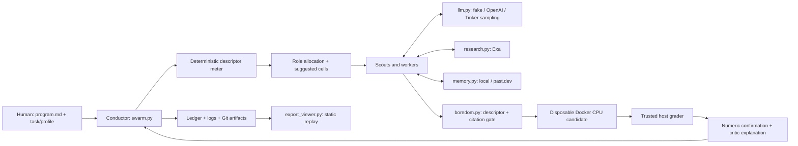
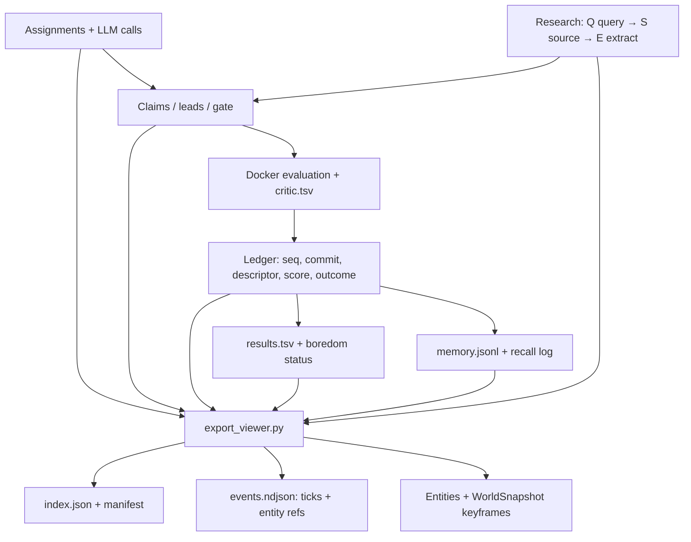

# Artificial Scientist Swarms: backend

Artificial Scientist Swarms is a system for autonomous research that uses a
**boredom meter to redirect search when local refinement stops paying off**. Agents propose code,
run CPU experiments, and keep measured improvements. The meter is a search-control
signal, not a claim that agents feel bored.

This is the hackathon judges' backend entry point. The runnable backend here is
the Artificial Scientist Swarms autoresearch backend (source baseline `3b50aaf`).
The Ig Nobel research community is a separate backend on `main`, not another mode of `swarm.py`.
Unmerged work is labeled below.

## Reading map

- [Architecture and round loop](#architecture-and-round-loop)
- [Types of agents](#types-of-agents)
- [Swarm types and fair comparisons](#swarm-types-and-fair-comparisons)
- [Exact boredom formulas](#boredom-meter-exact-cpu-implementation)
- [Benchmarks and sandbox](#cpu-benchmarks-and-sandbox)
- [Grounding and memory](#grounding-and-memory)
- [Artifacts and viewer](#run-artifacts-and-viewer)
- [Quickstart and tests](#quickstart-and-tests)
- [Limitations](#honest-limitations)

The Karpathy-style protocol separates human instructions from agent edits:
**the human edits [program.md](program.md)**; agents edit only the Python file
declared by their task. `prompts/` contains common, scout, proposal, repair and
critic templates. Task contracts and profiles live in `testcases/<task>/`.

**No GPU training:** `llm.py:LLMClient._request_tinker` creates a sampling
client and sends the rendered prompt on each call. Tinker is used for stateless
LLM inference, not gradient updates or model training. Candidate evaluation is
CPU-only. This says nothing about the remote provider's inference hardware.

## Architecture and round loop



The conductor owns a Git worktree and four slots (`worker-1` … `worker-4`).
Each worker gets its own worktree at the same round base commit.
Proposal calls and CPU evaluations are iterated **sequentially** at this revision
(`swarm.py:orchestrate`, `run_evaluations`), despite the swarm terminology.

The orchestration loop (`swarm.py:orchestrate`) is:

1. Load task/profile and evaluate starting HEAD as the round-0 baseline.
2. Fold the shared ledger; compute swarm and per-agent B; assign four roles and
   optional scouts, recording the assignment and suggested descriptor cells.
3. Scouts recall memory, query/select/extract research and write implementation leads.
4. Each worker recalls outcomes/leads/claims, proposes an editable-file patch,
   checks prior art and commits it in its own worktree.
5. Gate each commit; repair or reassign within the bounded proposal attempts.
6. Evaluate passing candidates in Docker; choose the best provisional improvement.
7. Repeat that candidate's evaluation; apply the numeric mean predicate and,
   outside A, obtain the critic LLM explanation. Keep only a confirmed improvement.
8. Record every final outcome and memory, regenerate TSV/status, fast-forward
   a kept commit, commit artifacts, tag attempts and optionally push; repeat.

```mermaid
sequenceDiagram
  participant C as Conductor
  participant M as Meter / memory
  participant W as Scouts and workers
  participant G as Gate
  participant E as Docker + host grader
  participant K as Confirmation / critic
  C->>E: Evaluate baseline (round 0)
  loop Each round (1 to 10)
    C->>M: Read ledger; swarm and per-agent status
    C->>W: Assign four roles; scout if Exa enabled
    W->>M: Recall outcomes, leads and claims
    W->>W: Propose patch; check prior art
    W->>G: Commit + Descriptor / Source / Prior-art trailers
    G-->>W: Pass or repair/reassign (bounded attempts)
    C->>E: Evaluate passing candidates
    E-->>C: Loss or crash
    opt Best provisional improvement exists
      C->>K: Repeat evaluation; numeric mean check
      K-->>C: Acceptance + critic explanation outside arm A
    end
    C->>M: Append outcomes and result memories
    C->>C: Keep/discard; TSV, status, artifact commit, tags
  end
  Note over C: Static export is a separate command, not a round step
```

`worker_attempts` allows up to three attempts: initial proposal, repair, and
potential conductor-assigned descriptor-cell work in divergent regimes. This is
more specific than the simplified one-repair protocol text. The gate checks
descriptors, novelty distance and citations. Prior-art search supplies evidence,
not proof of scientific originality. Rejections are recorded.

**Acceptance is numeric, not the critic's opinion.** In
`swarm.py:acceptance_margin`, margin is `accept_margin` or, absent that, `eps`.
`candidate_is_provisional` requires `loss < previous_best - margin`.
Only the best provisional candidate is confirmed; `critic_accepts` requires a
successful second evaluation and
`(first_loss + second_loss)/2 < previous_best - margin`.
The critic LLM explains but cannot override this predicate. A skips the critic
LLM, not numeric confirmation.

**This is not a second-seed check:** `local_task_result` changes no seed.
Hadamard is deterministic; Playworld reuses its held-out seeds. A kept commit
fast-forwards the conductor. Each round writes memory, copies artifacts into
`experiments/swarm_<arm>`, commits them and tags attempts. `--no-push` disables
remote pushes, not local Git writes; fake mode also forces no-push.
There is **no per-round viewer publish hook** here.

## Types of agents

These are responsibilities, not separate trained models. Scouts are an extra
assignment on worker slots, not additional candidate slots. Gate and conductor
are deterministic Python control components, not LLM personas.

| Type / role | Reads | Writes / action | LLM prompt |
| --- | --- | --- | --- |
| Conductor | Task/profile, ledger, all status and evaluation results | Assignments, suggested/reserved cells, worktrees, outcomes, Git history, memory | None; `swarm.py` calls role prompts below |
| Scout | Brief, regime, memory, research query results/extracts | Queries, source selection, grounded implementation leads and lead memory | `prompts/scout_query.md`, `scout_pick.md`, `scout_lead.md` |
| Worker: exploit | Current best source, protocol, task inputs, status, recalled results/leads/claims | Focused local patch, descriptor, claim, predicted delta and research trailers | `prompts/worker_propose.md`; `worker_repair.md` on rejection |
| Worker: divergent | Same inputs plus suggested/assigned under-visited cells | Alternative mechanism/method patch, source-backed claim; conductor-cell repair if needed | Same worker prompts, role/regime-dependent instructions |
| Critic | Provisional claim, both measured losses, previous best, recent basin history | Verdict/explanation in critic.tsv and audit event; numeric predicate remains authoritative | `prompts/critic.md`; omitted in A |
| Gate | Commit trailers, descriptor/profile, ledger, research IDs | Pass/reasons and distance/citation audit in boredom_log.jsonl | None; `boredom.py:run_gate`, `meter.py:gate` |
| Ig Nobel researcher (main) | Private library, ideas/studies, peer conversation and instruments | Proposals/refinements, study code, abstracts and lessons in memory/events | Inline `ignobel/agents.py`: `propose`, `refine`, `talk`, `write_study_code`, `write_abstract`, `write_lesson`; not root prompts/ |
| Ig Nobel statistician (main) | Same agent interface; statistician specialization in AgentSpec | Research using statistical instruments; #7 adds peer design review | Same inline agent methods; #7 adds review/refine advice |
| Ig Nobel committee (main) | Finished study abstracts after the run | Independent judge scores/reasons | Inline `ignobel/committee.py` judge A/B prompts; never a round controller |
| Ig Nobel mother / daughter (#8, **not yet merged**) | Mother: meeting + daughter histories; daughter: private data/library | Mother founds/spawns labs, no studies; daughter acts as researcher | Inline `families.py` talk/propose_daughter and `agents.py`; not root prompts/ |

Root LLM role templates share `prompts/common.md`, including the human protocol.

## Swarm types and fair comparisons

### Artificial Scientist Swarms autoresearch backend: this branch

| Arm | Allocation / ablation |
| --- | --- |
| A: meter off | Fixed 3 exploit / 1 divergent; the divergent worker scouts if Exa is on. Meter gate disabled; no critic LLM. Shadow meter values remain available. |
| B: meter on | EXPLOIT 3/1; SNAP 1/3 with up to 2 scouts; BREAKOUT 0/4 with 2 scouts when Exa is on; CONVERGED uses a confirmation-only gate. |
| C | Meter path with Exa disabled. |
| D | Meter path defaulting to local memory instead of past.dev. |

Meter-enabled B/C/D allocation (`allocate_roles`) is exactly:

| Regime | Exploit / divergent worker slots | Scouts when Exa on / off |
| --- | --- | --- |
| EXPLOIT | 3 / 1 | 1 / 0 |
| BOREDOM_SNAP | 1 / 3 | min(2, 1 + bored-agent count) / 0 |
| PARADIGM_BREAKOUT | 0 / 4 | 2 / 0 |
| CONVERGED | 4 / 0 | 1 / 0; gate restricts workers to confirmation |

An agent is “bored” at per-agent B >=0.70. Bored agents sort by descending B,
then name; missing scout slots fill from the lowest-B remaining agents. Without
bored agents, the EXPLOIT divergent slot uses the lowest-B worker. Scouts are
divergent workers except in CONVERGED. C always has zero scouts; D's local-memory
default can be overridden by explicit memory backend settings. A always has
3/1 slots, regardless of shadow regime.

Sources: `swarm.py:allocate_roles`, `arm_environment`, `orchestrate`.
Compare the same task, starting HEAD, four slots, round budget, LLM and service
settings, with separate output directories. **This is not exact call/token-budget
matching:** scouts, repairs and the critic change call counts. Arm A also removes
the critic LLM; differences cannot all be attributed to boredom timing.

### Ig Nobel community: inspected main `be658b6`

Expert agents have private labs, ideas, studies, diaries and exchanges. A committee
judges studies **after** a run. `MOCK=1` substitutes fake chat, seeded embeddings
and canned search; mock studies still run in Docker. Real mode uses external
chat/search/memory and Modal study sandboxes. These are research simulations,
not real laboratory experiments. See the
[main Ig Nobel README](https://github.com/arii/caffeinated/blob/main/ignobel/README.md).

Main's `ignobel/run_arm.py:ARMS` has `full`, `random_snap`, `single`
(the off/never-snap single-agent control), `shared_memory` and `no_exchange`.
There is **no literal off arm or yoked_random on inspected main**.
Matching seeds/rosters and cached initial libraries aid reproducibility, but
single/shared/no-exchange also alter the experiment, not just meter timing.

Open PRs, inspected without switching this checkout:

- [#6](https://github.com/arii/caffeinated/pull/6), **not yet merged**:
  Modal timeout cleanup, Docker/Modal selection, CPU local embeddings,
  OpenAI-compatible/Tinker provider support, key rotation and completion handling.
- [#7](https://github.com/arii/caffeinated/pull/7), **not yet merged**:
  profile-driven private meter, frustration separation, cooldown/jitter, and
  `yoked_random`. It validates the paired full run's seed and agent count,
  then chooses random agents for the same per-round number of snaps, counting
  breakouts too. This controls frequency, not identical histories or costs.
- [#8](https://github.com/arii/caffeinated/pull/8), **not yet merged**,
  stacked on #6 rather than #7: biology/chemistry/physics mother departments
  talk first and found daughter labs. Mothers do no studies; daughters have
  private generated CSVs, seed libraries and meters. Bored families can spawn
  more labs; daughters meet through seeded chance encounters. Hidden effects
  are mother-generated, not empirical discoveries. Its older meter/random
  control must not be presented as already combined with #7's yoked policy.

## Boredom meter: exact CPU implementation

**Definition:** boredom B combines a novelty deficit, lack of significant
progress, and overload (failures or near-repeats):

```text
B = round(clip(0.45*(1-N) + 0.45*S + 0.10*O, 0, 1), 9)
```

N is rolling descriptor novelty, S is normalized stagnation, and
O=max(fail_rate,trivial_rate). This is the CPU implementation
(`boredom_meter/meter.py:fold`, lines 206–215; default weights at line 39),
not the different private Ig Nobel formula below.

The active descriptor meter is `boredom_meter/meter.py`, imported through
`boredom.py`. The older token/Jaccard helper `boredom.py:compute_meter` is
**not** this scoring path.

Inputs are an ordered ledger prefix and loaded domain profile. B uses no LLM,
clock, randomness, network or embeddings. Status contains canonical ledger and
effective-profile SHA-256 hashes. `attempt_events` includes keep/discard/crash
and excludes critic rows. **Rejects are audited but do not enter B** at this
revision; candidate crashes do.

### Formulas

Defaults: `meter.py:load_profile`; computations: `param_distance`,
`distance`, `sparseness`, `simpson`, `fold`.

| Quantity | Exactly implemented |
| --- | --- |
| Descriptor distance | First differing categorical level returns its weight: CPU mechanism 1.0, method 0.5. If both match, `round(0.25 * mean(parameter_distances),9)`. No parameters gives 0. |
| Ratio parameters | Missing on either side contributes 1. Otherwise x and y become `max(abs(value),1e-12)`; distance is `min(abs(log(x/y))/log(ratio),1)`. CPU value uses ratio 4. |
| Other scales | Linear: `min(abs(x-y)/((hi-lo) or 1),1)`; log first applies `log10(max(v,1e-300))` to bounds and values. Average over the union of parameter names. |
| Novelty N | Mean of the last k attempts' sparsenesses. Each sparseness is mean distance to the nearest knn **preceding** archive members (empty archive: 1); old sparsenesses are not recomputed. |
| Stagnation S | `min(streak/patience,1)`. Reset on a score strictly better than the last significant best by more than eps, otherwise increment. Raw best and significant best are separate. |
| Fail rate | Last k scoped attempts' fraction with a fail status (CPU: crash). |
| Trivial rate | Last k scoped attempts' fraction with nearest preceding archive distance **<0.05**. |
| Overload O | `max(fail_rate,trivial_rate)`. |
| Diversity | `1-sum(count(cell)^2)/n^2` on last k top-level mechanisms (empty: 0). Reported, not an extra B term. |
| Frontier stall | Attempts since any strict raw-best improvement; increments on failure or no improvement. Separate from epsilon-based stagnation. |

```text
B = round(clip(0.45*(1-N) + 0.45*S + 0.10*O, 0, 1), 9)
```

Status rounds metrics to six decimals (`r`); regime comparisons use nine-decimal B.
Empty status is B=0, N=1, EXPLOIT. Per-agent windows/streaks compare against the
**shared preceding archive**. Any global significant improvement resets all agent
streaks. Global regime drives allocation; per-agent B prioritizes bored workers
(allocation cutoff >=0.70, `swarm.py:allocate_roles`).

### Regimes and hysteresis

`fold` tests in order: significant improvement resets EXPLOIT; existing CONVERGED
stays; stall >=3*patience plus complete required top-level mechanism coverage
enters CONVERGED; fewer than min_attempts=3 stays EXPLOIT; then breakout, snap and
exit hysteresis. Required mechanisms default to all vocabulary mechanisms,
including baseline. This revision has no explicit “scored best exists” convergence
guard.


SNAP holds down to 0.55. BREAKOUT stays BREAKOUT while B >=0.55 even below 0.85.
There is **no timed cooldown** in the CPU meter. `gate` defaults to recent-distance
minimum 0.35 and failed/discarded-distance minimum 0.25 outside EXPLOIT.
Exploit-role workers are exempt from the former only. BREAKOUT also rejects a
recent top-level mechanism; CONVERGED allows the best descriptor only.
`boredom.py:run_gate` adds research-trailer checks; arm A disables meter gating
and Exa-off disables prior-art requirements.

| Profile under testcases/ | eps (default accept_margin) | k / knn / patience |
| --- | --- | --- |
| hadamard19/boredom_profile.json | 0.005 | 5 / 3 / 5 |
| bixbench_mini/boredom_profile.json | 0.03 | 5 / 3 / 5 |
| playworld_mini/boredom_profile.json | 0.005 | 5 / 3 / 5 |

None explicitly sets accept_margin. Eps is configured, not learned.
Profiles define closed vocabularies, objective direction, parameter scales and
directives. Reusable non-CPU examples are
`boredom_meter/profiles/biolab_growth.json` and `compbio_pipeline.json`.
See [meter CLI documentation](boredom_meter/README.md); the code takes precedence
over older conceptual descriptions there.

### Ig Nobel uses a different meter

On main, `ignobel/boredom.py:components` computes
`clip(0.5*similarity + 0.5*unsurprise - 0.5*failure,0,1)`, rounded to four decimals.
Similarity is clipped mean cosine of newest versus up to five previous ideas
(fewer than two: 0). Unsurprise is mean 1-gap over the last five replicated studies
(none: 0). Gap is 1 for missing/wrong direction, otherwise
`min(abs(abs(predicted)-abs(actual))/(abs(predicted)+abs(actual)),1)`
(zero denominator: 0). Failure is the last-five crashed/unreplicated fraction
(none: 0). `config.yaml` sets snap at 0.50, overriding policy default 0.70.
Main has no multi-regime cooldown policy.

**PR #7, not yet merged:** `ignobel/boredom.py:components` and
`boredom_meter/profiles/ignobel.json:agent_meter` replace this with:

```text
B = clip(0.30*self_repeat + 0.25*ext_familiar + 0.20*unsurprise + 0.25*stall,0,1)
```

- `self_repeat=clip(((similarity-base_mu)/base_sd)/3,0,1)`; baseline is
  round-0 idea cosine against its own seeded library (zero sd becomes 1;
  missing baseline mean/sd 0/1). Similarity uses up to five previous ideas
  since exploration; fewer than two gives self_repeat 0.
- `ext_familiar=clip(1-idea.novelty,0,1)` (missing: 0), using external novelty
  unlike CPU B. Unsurprise/gap retain the definitions above.
  `stall=min(1,max(0,round-last_progress_round)/3)`; progress is a replicated
  new descriptor cell or gap >=0.5. Components round to four decimals.
- Frustration is last-five failed/unreplicated fraction and **not part of B**.
  At >=0.6, design review is requested when a statistician is available.
- `policy.py:decide` prioritizes convergence, frustration, pending breakout/
  cooldown, then snap. Snap requires two consecutive rounds at
  `B >= 0.5 + jitter`; seeded per-agent jitter is uniform in [-0.05,0.05],
  rounded to four decimals. Exploration resets similarity history and starts
  two-round cooldown. Pending breakout at elapsed >=2 and stall >=0.8 is checked
  **before** cooldown (elapsed <=2).
- Convergence: current idea has a study; last two studies replicated with
  gaps <=0.2; ext_familiar <=0.5. Replicate once more, then sticky hold.

**PR #8, not yet merged:** family spawning uses mean daughter B >=0.40,
two-round spawn cooldown and fewer than five daughters per mother; initial
founding defaults to two per mother (`ignobel/config.yaml`, `world.py`).
These are population rules, not #7's private exploration policy.

## CPU benchmarks and sandbox

| Task | Honest scope and metric | Editable |
| --- | --- | --- |
| hadamard19 | **exact; known optimum**. Valid 19×19 ±1 matrix; integer Bareiss determinant; nonzero-det loss = log10(2^18*3411968)-log10(abs(det)). Loss 0 matches the optimum. | construct.py |
| bixbench_mini | **17-question subset, not full BixBench**. Host answer-key accuracy; loss=1-accuracy. Published reference accuracy 0.523 is not a full-benchmark swarm result. | analysis.py |
| playworld_mini | **synthetic proxy, not PlayWorld**. 9×9 environment, 10 context frames, 20 future 5×5 frames, 200 held-out episodes; exact-frame fraction, loss=1-score; 8-frame-memory reference score 0.3598. | world_model.py |

Sources: each task's `task.json` and `evaluate.py`;
[task documentation](testcases/README.md). First BixBench preparation downloads
public data; it is not fully offline on an empty cache.

`testcases/sandbox.py:run_candidate` is **fail-closed**: unavailable Docker/image
or sandbox startup failure produces a crash, never host candidate execution.
The pinned `testcases/Dockerfile` image uses network none, read-only root,
dropped capabilities, no-new-privileges, non-root UID and PID/CPU/memory/time
limits. Stdout/stderr and output are bounded. Only declared public files,
editable source and required harness enter a read-only work mount, with a
separate output mount: no repository, home, hidden answers, reference solutions
or host environment credentials.

**Trusted host graders never import candidate code.** Hadamard parses a JSON
matrix, BixBench an answer dictionary. Playworld's `run_candidate.py` imports the
model **inside Docker** and returns predictions. Hidden future frames and the
simulator stay on the host; BixBench's answer key remains in host `.cache/`.
This container boundary is not proof against runtime/kernel vulnerabilities.
Task preparation and graders are trusted code.

## Grounding and memory

`research.py` wraps Exa prior-art search, paper/code scouting, similar-source
lookup and extraction. Q/S/E identifiers link queries, sources and extracts;
logs include cost/latency and cached responses. `EXA=off` records disabled
queries without a service call. Scouts turn sources into implementation leads;
workers check prior art and cite IDs in proposals and commit trailers.

`memory.py` supports none, local JSONL recall and past.dev. The swarm writes
assignments, claims, leads and outcomes; workers recall results, leads and current
claims. A/B default to past.dev: select `MEMORY_BACKEND=local` for offline use.
Environment names include `EXA_API_KEY`, `PAST_API_KEY`, and arm-specific
`PAST_API_KEY_A` / `PAST_API_KEY_B`; values do not belong in docs or artifacts.

Past.dev has per-arm audiences/recall identities (`ensure_arm_audience`),
arm/run_id metadata (`arm_run_scope`) and post-recall evidence filtering
(`scoped_pastdev_response`). Known current-run IDs and metadata determine
eligibility; other-run records are dropped. This is application retrieval
isolation, not separate infrastructure. Local recall reads the selected mirror;
separate output directories isolate local arms. Retrieval is outside CPU B.

## Run artifacts and viewer

CPU writer contracts under --out (or conductor experiments/swarm_<arm>):

| File | Key fields / purpose | Writer |
| --- | --- | --- |
| ledger.jsonl | seq, ts, kind baseline/candidate/critic, agent, status, score (loss), descriptor, sources, commit, round; candidate replicate_score, role, gate_reasons, gate_attempts | meter.submit; swarm.add_result_event/orchestrate |
| results.tsv | commit, loss, memory_gb, status, description, agent, round, descriptor, kind; CPU memory_gb=0.0 | swarm.write_results |
| assignments.jsonl | ts, round, swarm_B, regime, per_agent_B, per_agent_boredom, roles, scouts, rationale, ledger/profile hashes | swarm.append_assignment |
| boredom_log.jsonl | type=gate: candidate_commit, pass/reasons, descriptor, sources/prior_art; type=status: B, regime, best_loss/best_seq, frontier_stall, hashes; timestamps. Full per-agent components are in assignments. | boredom.run_gate; swarm.append_status |
| research_log.jsonl | query id/purpose/agent/regime/endpoint/query/n_results/cost/latency_ms, optional disabled; source id/query_id/url/title/published/highlights; extract records when used | research.append_query_record/write_query_results/run_extract |
| memory.jsonl | id, sourceId, label, content, author, metadata, timestamp; memory type is metadata.type, alongside arm/round/commit/status as appropriate | memory.write/append_mirror |
| memory_log.jsonl | writes/recalls: backend, agent, query or ID, latency, evidence/source IDs, counts, pending/dropped counts where applicable | memory.write/recall |
| llm_log.jsonl | ts, role, agent, round, model, prompt_sha, full prompt, parsed response, latency_ms, usage, optional attempts | llm.LLMClient.call |
| critic.tsv | round, commit, run1_loss, run2_loss, accepted, verdict, why | swarm.update_critic_tsv |
| run_id | Persisted UUID hex for memory run scope | swarm.orchestrate |
| run.json | **Not written here.** Export manifest.json is separate; no run.json writer exists in swarm.py. | — |

Other outputs include runs/<commit>.log, critic confirmation logs and Exa cache.
Full prompts/responses/retrieved content need review before sharing.



`export_viewer.py` implements static **swarm-viewer/v1** for CPU and Ig Nobel
artifacts. UUIDv5 run/agent/event IDs are deterministic for the same inputs;
ticks start at 0 and are gap-free. Events include round starts, assignments,
boredom measurements, questions, observations, hypotheses, gates, experiments,
verdicts and discoveries, plus Ig Nobel talk/share/diary events. Entity references
link evidence and discovery lineage. A reducer produces WorldSnapshot state;
round-end and periodic keyframes support seek.

Output: index.json, <run_id>/manifest.json, timeline.json, events.ndjson,
keyframes/<tick>.json and entities/<kind>.json. Manifest provenance includes
LLM, CPU evaluation and Exa/memory settings. The manifest's command and
swarm_commit are empty strings and provenance.artifacts is an empty object here,
not populated hashes. Missing timestamps
stay null. Prompt/response/reasoning text stays in entities/llm_calls.json, not
timeline events. Run identity also depends on input directory name and first
timestamp: renaming inputs is not guaranteed to preserve it.

The full [docs/swarm-viewer-api.md contract](https://github.com/arii/caffeinated/blob/main/docs/swarm-viewer-api.md)
was merged to main in #9 but is absent from this branch. It is a design document:
its opening “nothing implemented” and old GPU/timestamp/log-gap notes predate this
CPU exporter. Current writer/exporter code is authoritative for implementation
status; the design document alone does not establish running endpoints.

### Read-only /api/v1 and live mode: not yet merged

The proposed GET-only surface lists runs, timeline, world at a tick, events,
agents/collections, ledger, discoveries, entities and artifacts, with optional
SSE. It cannot start/stop runs or influence agents; see the contract for shapes.

Implementation work is tracked on `agent/devin/swarm-viewer-impl` and
`agent/devin/viewer-live-publish`. Neither is merged into inspected
origin/autoresearch (`3b50aaf`); neither remote branch was advertised at initial
inspection. **Not yet merged:** no server/live command is supported by this
README. The supported path is a finished run plus an explicit static export.

Final fetch for this documentation still found origin/autoresearch at 3b50aaf;
the two named implementation branches were not advertised. A separate
origin/agent/devin/viewer-api branch was advertised, but was not inspected and
is not evidence that the API is merged here.

## Quickstart and tests

From repository root: Python >=3.10, Git and a working Docker daemon.
Root declares no mandatory Python dependencies; Tinker extras need Python >=3.11.
Build once (the build pulls packages; candidate containers have no network):

```sh
docker build -t caffeinated-testcases:py311-v1 -f testcases/Dockerfile testcases
EXA=off MEMORY_BACKEND=local python3 swarm.py --task hadamard19 --rounds 1 --llm fake --no-push --out /tmp/readme_check
python3 export_viewer.py /tmp/readme_check --dest /tmp/readme_viewer
```

Use fresh output directories; keep valuable outputs outside /tmp. Fake mode is
an offline plumbing check, not evidence of autonomous discoveries; it still needs
Docker. The runner creates local branches/worktrees/tags and artifact commits:
use your own checkout and preserve others' work. Export prints its generated path.

Tinker setup (not live-service verified for this documentation):

```sh
python3 -m venv .venv
.venv/bin/python -m pip install 'tinker==0.39.0' 'tml-renderers==0.4.1'
# Supply TINKER_API_KEY and TINKER_MODEL in the environment; no values in files.
EXA=off MEMORY_BACKEND=local .venv/bin/python swarm.py --task hadamard19 --arm B --rounds 10 --llm tinker --no-push --out out/tinker-B
```

Kimi K3.1 also needs PyTorch 2.10+ for the renderer path (`llm.py` reports this
requirement); extras alone do not guarantee every renderer/model combination.
Compare arm A in a separate output directory at the same HEAD and settings.

```sh
EXA=off MEMORY_BACKEND=local python3 -m unittest discover -s tests -v
python3 -m unittest discover -s boredom_meter/tests -v
```

Docker cases need the image above; BixBench integration may prepare public data.
Inspect skips rather than treating skipped sandbox tests as security evidence.

Ig Nobel commands belong in a **separate main worktree**, not this branch's
empty ignobel/ directory. From that worktree's ignobel/:

```sh
python3 -m venv .venv
.venv/bin/python -m pip install -r requirements.txt
MOCK=1 .venv/bin/python run_arm.py --arm full --agents 4 --rounds 3 --seed 0
MOCK=1 .venv/bin/python -m pytest -q
```

Mock study tests require Docker (python:3.11-slim, or IGNOBEL_SANDBOX_IMAGE).
Do not use PR #7/#8 flags against main before they land.

### Verification at the documented revision

The exact fake command above evaluated four candidates with status ok, produced
five ledger rows (baseline + four discards), one assignment, five boredom log
rows, four disabled research queries, nine memory items, 21 memory operations
and four LLM calls. Best loss stayed 0.058514; no candidate was confirmed.
There was no run.json. The exporter wrote a swarm-viewer/v1 run directory.

Root tests: 67 run, OK, one skip (removed training-era replay fixture).
Meter tests: 23 run, OK. Ig Nobel main tests: 56 passed, using the environment's
existing ignobel/.venv interpreter from a separate detached main worktree.
No live Tinker/Exa/past.dev/Modal calls were made. The CPU Docker image build
and public-data test preparation are separate from those research services.

### Formula and threshold source index

Line numbers refer to source baseline 3b50aaf unless a remote ref is stated:

| Formula / threshold | Exact source |
| --- | --- |
| CPU k/knn/patience, weights, regime thresholds, warmup, trivial and gate thresholds | `boredom_meter/meter.py:33-46` (`load_profile`) |
| Parameter scales / clamps / ratio formula | `boredom_meter/meter.py:91-112` (`param_distance`) |
| Hierarchical weights and rounding; nearest-neighbor novelty | `boredom_meter/meter.py:115-131` (`distance`, `sparseness`) |
| Strict improvement direction/margin | `boredom_meter/meter.py:134-142` (`is_better`, `score_ok`) |
| Diversity and eligible attempt statuses | `boredom_meter/meter.py:145-157` (`simpson`, `attempt_events`) |
| Archive, significant/raw best, streaks/stall, scoped windows, rates and B | `boredom_meter/meter.py:176-215` (`fold`) |
| Regime precedence / hysteresis / convergence | `boredom_meter/meter.py:216-233` (`fold`) |
| Six-decimal return rounding and empty defaults | `boredom_meter/meter.py:29-30,244-261` (`r`, `status`) |
| Gate distance restrictions | `boredom_meter/meter.py:300-340` (`gate`) |
| CPU eps, k/knn/patience, level/parameter weights, ratio 4 | `testcases/hadamard19/boredom_profile.json:6-20,44-48`; `testcases/bixbench_mini/boredom_profile.json:6-20,43-47`; `testcases/playworld_mini/boredom_profile.json:6-20,44-48` |
| Allocation cutoff and slot counts | `swarm.py:163-238` (`allocate_roles`) |
| Accept margin, provisional inequality, confirmation mean | `swarm.py:1120-1135` (`acceptance_margin`, `candidate_is_provisional`, `critic_accepts`) |
| Main Ig Nobel similarity/gap/unsurprise/failure/B and rounding | `origin/main:ignobel/boredom.py:15-58` |
| Main snap threshold override / policy default | `origin/main:ignobel/config.yaml:2`; `origin/main:ignobel/run_arm.py:37-40`; `origin/main:ignobel/policy.py:18-24` |
| #7 baseline, self_repeat, familiarity, gap, unsurprise, frustration | `origin/pr7:ignobel/boredom.py:27-97` |
| #7 progress, stall, weighted B, rounding | `origin/pr7:ignobel/boredom.py:110-144` |
| #7 weights and every private-policy threshold | `origin/pr7:boredom_meter/profiles/ignobel.json:24-37` |
| #7 jitter, convergence, cooldown, snap and window reset | `origin/pr7:ignobel/policy.py:39-105` |
| #8 family mean-B threshold, cooldown, cap and founding count | `origin/pr8:ignobel/config.yaml:8-11`; `origin/pr8:ignobel/world.py:301-311` |

## Honest limitations

- B operationalizes repetition/stall, not scientific value. Descriptors can be
  wrong or gamed; eps/thresholds need calibration.
- Known-optimum, subset and synthetic tasks do not establish full benchmark
  performance. No aggregate win-rate or causal boredom benefit is claimed here.
- Confirmation repeats evaluation rather than independently changing seeds.
  Equal slots/rounds are not equal tokens or identical histories.
- Static export works independently of the proposed read-only HTTP/live layer.
  Frontend rendering/visual replay was not verified.
- Fake mode does not validate Tinker, Exa, past.dev or Modal reliability.
  Main's Ig Nobel Modal/past.dev paths still have verification TODOs; #6 does
  not mean those services were exercised for this documentation.
- Ig Nobel yoked/family changes are separate unmerged work, not one integrated
  backend. Mother-generated hidden effects remain simulations.
