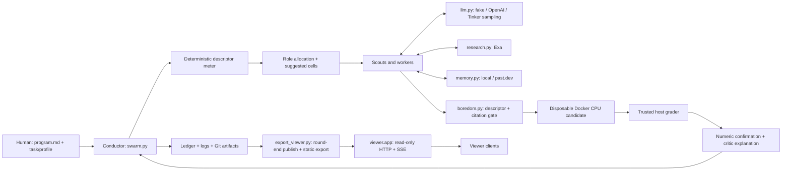
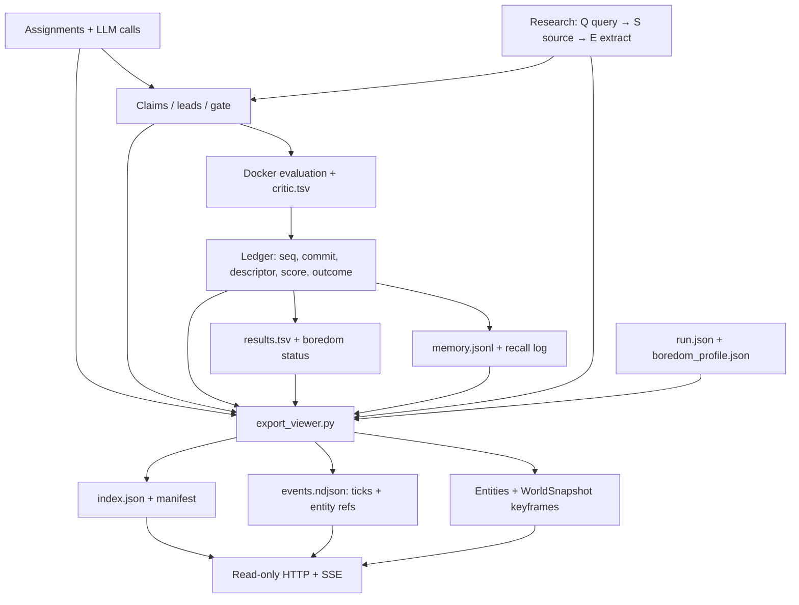

# Artificial Scientist Swarms: backend

Artificial Scientist Swarms uses a **boredom meter to redirect autonomous research
when local refinement stops paying off**. Agents propose code changes, evaluate
them on CPU benchmarks, and keep measured improvements. This entry point
describes the runnable autoresearch backend at source baseline `add9002` and
distinguishes it from the separate Ig Nobel research community on `main`.
The meter controls search rather than claiming that agents feel bored, and
features that are not yet merged are labeled throughout.

Core concepts: [agent types](#types-of-agents) · [boredom B](#boredom-meter-exact-cpu-implementation) · [orchestration loop](#orchestration-loop)

## Reading map

- [Architecture and round loop](#architecture-and-round-loop)
- [Types of agents](#types-of-agents)
- [Swarm types and fair comparisons](#swarm-types-and-fair-comparisons)
- [Exact boredom formulas](#boredom-meter-exact-cpu-implementation)
- [Benchmarks and sandbox](#cpu-benchmarks-and-sandbox)
- [Grounding and memory](#grounding-and-memory)
- [Artifacts and viewer](#run-artifacts-and-viewer)
- [Quickstart and tests](#quickstart-and-tests)
- [Limitations](#honest-limitations)

The Karpathy-style protocol separates human instructions from agent edits:
**the human edits [program.md](program.md)**; agents edit only the Python file
declared by their task. `prompts/` contains common, scout, proposal, repair and
critic templates. Task contracts and profiles live in `testcases/<task>/`.

**No GPU training:** `llm.py:LLMClient._request_tinker` creates a sampling
client and sends the rendered prompt on each call. Tinker is used for stateless
LLM inference, not gradient updates or model training. Candidate evaluation is
CPU-only; the remote provider may use different hardware for inference.

## Architecture and round loop



## Types of agents

These are responsibilities, not separate trained models. Scouts are an extra
assignment on worker slots, not additional candidate slots. Gate and conductor
are deterministic Python control components, not LLM personas.

| Type / role | Reads | Writes / action | LLM prompt |
| --- | --- | --- | --- |
| Conductor | Task/profile, ledger, all status and evaluation results | Assignments, suggested/reserved cells, worktrees, outcomes, Git history, memory, run metadata and round-end/final viewer publishes | None; `swarm.py` calls role prompts below |
| Scout | Brief, regime, memory, research query results/extracts | Queries, source selection, grounded implementation leads and lead memory | `prompts/scout_query.md`, `scout_pick.md`, `scout_lead.md` |
| Worker: exploit | Current best source, protocol, task inputs, status, recalled results/leads/claims | Focused local patch, descriptor, claim, predicted delta and research trailers | `prompts/worker_propose.md`; `worker_repair.md` on rejection |
| Worker: divergent | Same inputs plus suggested/assigned under-visited cells | Alternative mechanism/method patch, source-backed claim; conductor-cell repair if needed | Same worker prompts, role/regime-dependent instructions |
| Critic | Provisional claim, both measured losses, previous best, recent basin history | Verdict/explanation in critic.tsv and audit event; numeric predicate remains authoritative | `prompts/critic.md`; omitted in A |
| Gate | Commit trailers, descriptor/profile, ledger, research IDs | Pass/reasons and distance/citation audit in boredom_log.jsonl | None; `boredom.py:run_gate`, `meter.py:gate` |
| Ig Nobel researcher (main) | Private library, ideas/studies, peer conversation and instruments | Proposals/refinements, study code, abstracts and lessons in memory/events | Inline `ignobel/agents.py`: `propose`, `refine`, `talk`, `write_study_code`, `write_abstract`, `write_lesson`; not root prompts/ |
| Ig Nobel statistician (main) | Same agent interface; statistician specialization in AgentSpec | Research using statistical instruments; #7 adds peer design review | Same inline agent methods; #7 adds review/refine advice |
| Ig Nobel committee (main) | Finished study abstracts after the run | Independent judge scores/reasons | Inline `ignobel/committee.py` judge A/B prompts; never a round controller |
| Ig Nobel mother / daughter (#8, **not yet merged**) | Mother: meeting + daughter histories; daughter: private data/library | Mother founds/spawns labs, no studies; daughter acts as researcher | Inline `families.py` talk/propose_daughter and `agents.py`; not root prompts/ |

Root LLM role templates share `prompts/common.md`, including the human protocol.

The viewer API is a separate read-only process, not an agent or a controller.
It reads published artifacts and serves HTTP and SSE without using an LLM prompt.

## Orchestration loop

The conductor owns a Git worktree and four slots (`worker-1` … `worker-4`).
Each worker gets its own worktree at the same round base commit.
Proposal calls and CPU evaluations are iterated **sequentially** at this revision
in `swarm.py:_orchestrate` and `run_evaluations`; the worker slots do not imply
parallel execution.

The conductor implements the following loop in `swarm.py:_orchestrate`:

1. Load the task and profile, then evaluate the starting HEAD as the round-0 baseline.
2. Fold the shared ledger to compute swarm and per-agent B, then assign four
   roles and optional scouts. Record the assignment and suggested descriptor cells.
3. Have scouts recall memory, search and select research sources, extract relevant
   findings, and write implementation leads.
4. Have each worker recall outcomes, leads and claims, propose an editable-file
   patch, check prior art, and commit the patch in its own worktree.
5. Check each commit at the gate, then repair or reassign rejected work within
   the bounded proposal attempts.
6. Evaluate passing candidates in Docker and choose the best provisional improvement.
7. Repeat that candidate's evaluation and apply the numeric mean predicate.
   Outside arm A, obtain the critic LLM explanation. Keep only a confirmed improvement.
8. Record every final outcome and memory, regenerate the TSV and status, and
   fast-forward to a kept commit. Commit artifacts, tag attempts and optionally
   push. Publish the viewer state at the end of the round before starting the
   next one, unless `--no-viewer` is set. On exit, publish a final `finished` or
   `stopped` state.

```mermaid
sequenceDiagram
  participant C as Conductor
  participant M as Meter / memory
  participant W as Scouts and workers
  participant G as Gate
  participant E as Docker + host grader
  participant K as Confirmation / critic
  participant V as Viewer publisher / HTTP API
  C->>E: Evaluate baseline (round 0)
  loop Each round (1 to 10)
    C->>M: Read ledger; swarm and per-agent status
    C->>W: Assign four roles; scout if Exa enabled
    W->>M: Recall outcomes, leads and claims
    W->>W: Propose patch; check prior art
    W->>G: Commit + Descriptor / Source / Prior-art trailers
    G-->>W: Pass or repair/reassign (bounded attempts)
    C->>E: Evaluate passing candidates
    E-->>C: Loss or crash
    opt Best provisional improvement exists
      C->>K: Repeat evaluation; numeric mean check
      K-->>C: Acceptance + critic explanation outside arm A
    end
    C->>M: Append outcomes and result memories
    C->>C: Keep/discard; TSV, status, artifact commit, tags
    C->>V: Publish running state unless --no-viewer
  end
  C->>V: Publish final finished/stopped state unless --no-viewer
  Note over V: HTTP/SSE reads published files; it does not control the run
```

`worker_attempts` allows up to three attempts: initial proposal, repair, and
potential conductor-assigned descriptor-cell work in divergent regimes. This is
more specific than the simplified one-repair protocol text. The gate checks
descriptors, novelty distance and citations. Prior-art search supplies evidence,
not proof of scientific originality. Rejections are recorded.

**Acceptance is numeric, not the critic's opinion.** In
`swarm.py:acceptance_margin`, margin is `accept_margin` or, absent that, `eps`.
`candidate_is_provisional` requires `loss < previous_best - margin`.
Only the best provisional candidate is confirmed; `critic_accepts` requires a
successful second evaluation and
`(first_loss + second_loss)/2 < previous_best - margin`.
The critic LLM explains the result but cannot override this predicate. Arm A
skips the critic LLM, but still performs numeric confirmation.

**This is not a second-seed check:** `local_task_result` changes no seed.
Hadamard is deterministic, and Playworld reuses its held-out seeds. The conductor
fast-forwards to a kept commit. Each round writes memory, copies artifacts into
`experiments/swarm_<arm>`, commits them and tags attempts. `--no-push` disables
remote pushes, not local Git writes; fake mode also forces no-push.
The conductor calls `publish_viewer_state` at each round end and again on exit.
By default it writes under `<out>/viewer`; `--viewer-dest PATH` selects another
export root, and `--no-viewer` disables publishing. Publish failures are logged
without failing the research run.

## Swarm types and fair comparisons

### Artificial Scientist Swarms autoresearch backend: this branch

| Arm | Allocation / ablation |
| --- | --- |
| A: meter off | Fixed 3 exploit / 1 divergent; the divergent worker scouts if Exa is on. Meter gate disabled; no critic LLM. Shadow meter values remain available. |
| B: meter on | EXPLOIT 3/1; SNAP 1/3 with up to 2 scouts; BREAKOUT 0/4 with 2 scouts when Exa is on; CONVERGED uses a confirmation-only gate. |
| C: meter on, Exa off | The meter controls allocation, but Exa is disabled. |
| D: meter on, local memory | The meter controls allocation, and memory defaults to local storage instead of past.dev. |

For the meter-enabled B/C/D arms, `allocate_roles` assigns the following slots:

| Regime | Exploit / divergent worker slots | Scouts when Exa on / off |
| --- | --- | --- |
| EXPLOIT | 3 / 1 | 1 / 0 |
| BOREDOM_SNAP | 1 / 3 | min(2, 1 + bored-agent count) / 0 |
| PARADIGM_BREAKOUT | 0 / 4 | 2 / 0 |
| CONVERGED | 4 / 0 | 1 / 0; gate restricts workers to confirmation |

An agent counts as “bored” when its per-agent B >=0.70. The conductor sorts
bored agents by descending B, then by name, and fills remaining scout slots
from the lowest-B available agents. If no agents are bored, the EXPLOIT divergent
slot goes to the lowest-B worker. Scouts are divergent workers except in
CONVERGED. Arm C always has zero scouts. Explicit memory backend settings can
override arm D's local-memory default. Arm A always has three exploit slots and
one divergent slot, regardless of its shadow regime.

These rules are implemented in `swarm.py:allocate_roles`, `arm_environment` and
`_orchestrate`. For a comparison, use the same task, starting HEAD, four slots,
round budget, LLM and service settings, with separate output directories. **This is not exact call/token-budget
matching:** scouts, repairs and the critic change call counts. Arm A also removes
the critic LLM; differences cannot all be attributed to boredom timing.

### Ig Nobel community: inspected main `be658b6`

Expert agents have private labs, ideas, studies, diaries and exchanges. A committee
judges studies **after** a run. `MOCK=1` substitutes fake chat, seeded embeddings
and canned search; mock studies still run in Docker. Real mode uses external
chat/search/memory and Modal study sandboxes. These are research simulations,
not real laboratory experiments. See the
[main Ig Nobel README](https://github.com/arii/caffeinated/blob/main/ignobel/README.md).

Main's `ignobel/run_arm.py:ARMS` has `full`, `random_snap`, `single`
(the off/never-snap single-agent control), `shared_memory` and `no_exchange`.
There is **no literal off arm or yoked_random on inspected main**.
Matching seeds/rosters and cached initial libraries aid reproducibility, but
single/shared/no-exchange also alter the experiment, not just meter timing.

The following open PRs describe separate extensions:

- [#6](https://github.com/arii/caffeinated/pull/6), **not yet merged**:
  Modal timeout cleanup, Docker/Modal selection, CPU local embeddings,
  OpenAI-compatible/Tinker provider support, key rotation and completion handling.
- [#7](https://github.com/arii/caffeinated/pull/7), **not yet merged**:
  profile-driven private meter, frustration separation, cooldown/jitter, and
  `yoked_random`. It validates the paired full run's seed and agent count,
  then chooses random agents for the same per-round number of snaps, counting
  breakouts too. This controls frequency, not identical histories or costs.
- [#8](https://github.com/arii/caffeinated/pull/8), **not yet merged**,
  stacked on #6 rather than #7: biology/chemistry/physics mother departments
  talk first and found daughter labs. Mothers do no studies; daughters have
  private generated CSVs, seed libraries and meters. Bored families can spawn
  more labs; daughters meet through seeded chance encounters. Hidden effects
  are mother-generated, not empirical discoveries. Its older meter/random
  control must not be presented as already combined with #7's yoked policy.

## Boredom meter: exact CPU implementation

**Definition:** boredom B combines a novelty deficit, lack of significant
progress, and overload (failures or near-repeats):

```text
B = round(clip(0.45*(1-N) + 0.45*S + 0.10*O, 0, 1), 9)
```

N is rolling descriptor novelty, S is normalized stagnation, and overload is
O=max(fail_rate,trivial_rate). This is the CPU implementation
(`boredom_meter/meter.py:fold`, lines 206–215; default weights at line 39),
not the different private Ig Nobel formula below. The
[formula source reference](docs/backend.md) lists line-level citations for every
formula and threshold in this section.

The active descriptor meter is `boredom_meter/meter.py`, imported through
`boredom.py`. The older token/Jaccard helper `boredom.py:compute_meter` is
**not** this scoring path.

The inputs are an ordered ledger prefix and a loaded domain profile. Computing
B uses no LLM, clock, randomness, network or embeddings. The returned status
contains canonical ledger and effective-profile SHA-256 hashes.
`attempt_events` includes rows with keep, discard or crash status and excludes
critic rows. **Rejects are audited but do not enter B** at this
revision; candidate crashes do.

### Formulas

`meter.py:load_profile` supplies the defaults. The functions `param_distance`,
`distance`, `sparseness`, `simpson` and `fold` compute the quantities below.

| Quantity | Exactly implemented |
| --- | --- |
| Descriptor distance | First differing categorical level returns its weight: CPU mechanism 1.0, method 0.5. If both match, `round(0.25 * mean(parameter_distances),9)`. No parameters gives 0. |
| Ratio parameters | Missing on either side contributes 1. Otherwise x and y become `max(abs(value),1e-12)`; distance is `min(abs(log(x/y))/log(ratio),1)`. CPU value uses ratio 4. |
| Other scales | Linear: `min(abs(x-y)/((hi-lo) or 1),1)`; log first applies `log10(max(v,1e-300))` to bounds and values. Average over the union of parameter names. |
| Novelty N | Mean of the last k attempts' sparsenesses. Each sparseness is mean distance to the nearest knn **preceding** archive members (empty archive: 1); old sparsenesses are not recomputed. |
| Stagnation S | `min(streak/patience,1)`. Reset on a score strictly better than the last significant best by more than eps, otherwise increment. Raw best and significant best are separate. |
| Fail rate | Last k scoped attempts' fraction with a fail status (CPU: crash). |
| Trivial rate | Last k scoped attempts' fraction with nearest preceding archive distance **<0.05**. |
| Overload O | `max(fail_rate,trivial_rate)`. |
| Diversity | `1-sum(count(cell)^2)/n^2` on last k top-level mechanisms (empty: 0). Reported, not an extra B term. |
| Frontier stall | Attempts since any strict raw-best improvement; increments on failure or no improvement. Separate from epsilon-based stagnation. |

```text
B = round(clip(0.45*(1-N) + 0.45*S + 0.10*O, 0, 1), 9)
```

The returned status rounds metrics to six decimals using `r`, while regime
comparisons use nine-decimal B. An empty ledger returns B=0, N=1 and EXPLOIT.
Per-agent scoring uses its own windows and streaks but compares novelty against
the **shared preceding archive**. Any global significant improvement resets all
agent streaks. The global regime drives allocation, while per-agent B prioritizes
bored workers at the >=0.70 cutoff in `swarm.py:allocate_roles`.

### Regimes and hysteresis

`fold` checks the regime conditions in a fixed order. A significant improvement
resets the regime to EXPLOIT; otherwise, an existing CONVERGED regime persists.
A stall >=3*patience together with complete required top-level mechanism coverage
enters CONVERGED. If none of those conditions applies, fewer than min_attempts=3
attempts keeps the regime in EXPLOIT; the function then checks breakout, snap and
exit hysteresis. Required mechanisms default to all vocabulary mechanisms,
including baseline. This revision does not explicitly require a scored best
before entering CONVERGED.


SNAP remains active down to 0.55. BREAKOUT also remains active while B >=0.55,
even if B falls below 0.85.
There is **no timed cooldown** in the CPU meter. `gate` defaults to recent-distance
minimum 0.35 and failed/discarded-distance minimum 0.25 outside EXPLOIT.
Exploit-role workers are exempt from the former only. BREAKOUT also rejects a
recent top-level mechanism; CONVERGED allows the best descriptor only.
`boredom.py:run_gate` adds research-trailer checks; arm A disables meter gating
and Exa-off disables prior-art requirements.

| Profile under testcases/ | eps (default accept_margin) | k / knn / patience |
| --- | --- | --- |
| hadamard19/boredom_profile.json | 0.005 | 5 / 3 / 5 |
| bixbench_mini/boredom_profile.json | 0.03 | 5 / 3 / 5 |
| playworld_mini/boredom_profile.json | 0.005 | 5 / 3 / 5 |

None of these profiles explicitly sets accept_margin. Eps is a configured value,
not a learned value.
Profiles define closed vocabularies, objective direction, parameter scales and
directives. Reusable non-CPU examples are
`boredom_meter/profiles/biolab_growth.json` and `compbio_pipeline.json`.
See [meter CLI documentation](boredom_meter/README.md); the code takes precedence
over older conceptual descriptions there.

### Ig Nobel uses a different meter

On main, `ignobel/boredom.py:components` computes
`clip(0.5*similarity + 0.5*unsurprise - 0.5*failure,0,1)`, rounded to four decimals.
Similarity is the clipped mean cosine of the newest idea versus up to five
previous ideas; it is 0 when fewer than two ideas are available. Unsurprise is
the mean of 1-gap over the last five replicated studies, or 0 if there are none.
Gap is 1 when the direction is missing or wrong; otherwise it is
`min(abs(abs(predicted)-abs(actual))/(abs(predicted)+abs(actual)),1)`
(or 0 when the denominator is zero). Failure is the fraction of the last five
studies that crashed or did not replicate, or 0 if there are none.
`config.yaml` sets the snap threshold at 0.50, overriding the policy default of 0.70.
Main has no multi-regime cooldown policy.

**PR #7, not yet merged:** `ignobel/boredom.py:components` and
`boredom_meter/profiles/ignobel.json:agent_meter` replace this with:

```text
B = clip(0.30*self_repeat + 0.25*ext_familiar + 0.20*unsurprise + 0.25*stall,0,1)
```

- Self-repetition is `self_repeat=clip(((similarity-base_mu)/base_sd)/3,0,1)`.
  The baseline is the cosine of the round-0 idea against the agent's own seeded
  library. A zero standard deviation becomes 1; a missing baseline defaults
  to mean 0 and standard deviation 1. Similarity uses up to five previous ideas
  since exploration, and fewer than two gives self_repeat 0.
- External familiarity is `ext_familiar=clip(1-idea.novelty,0,1)`, or 0 when
  novelty is missing. Unlike CPU B, it uses external novelty. Unsurprise and gap
  retain the definitions above. Stall is
  `stall=min(1,max(0,round-last_progress_round)/3)`; progress means a replicated
  new descriptor cell or gap >=0.5. Components are rounded to four decimals.
- Frustration is the fraction of the last five studies that failed or did not
  replicate, and it is **not part of B**. At >=0.6, the policy requests a design
  review when a statistician is available.
- `policy.py:decide` prioritizes convergence, then frustration, then pending
  breakout and cooldown, and finally snap. Snap requires two consecutive rounds at
  `B >= 0.5 + jitter`; seeded per-agent jitter is uniform in [-0.05,0.05],
  rounded to four decimals. Exploration resets similarity history and starts
  a two-round cooldown. Pending breakout at elapsed >=2 and stall >=0.8 is checked
  **before** cooldown (elapsed <=2).
- Convergence requires the current idea to have a study, the last two studies
  to have replicated with gaps <=0.2, and ext_familiar <=0.5. The agent replicates
  once more and then remains on hold.

**PR #8, not yet merged:** family spawning uses mean daughter B >=0.40,
two-round spawn cooldown and fewer than five daughters per mother; initial
founding defaults to two per mother (`ignobel/config.yaml`, `world.py`).
These are population rules, not #7's private exploration policy.

## CPU benchmarks and sandbox

| Task | Honest scope and metric | Editable |
| --- | --- | --- |
| hadamard19 | **exact; known optimum**. Valid 19×19 ±1 matrix; integer Bareiss determinant; nonzero-det loss = log10(2^18*3411968)-log10(abs(det)). Loss 0 matches the optimum. | construct.py |
| bixbench_mini | **17-question subset, not full BixBench**. Host answer-key accuracy; loss=1-accuracy. Published reference accuracy 0.523 is not a full-benchmark swarm result. | analysis.py |
| playworld_mini | **synthetic proxy, not PlayWorld**. 9×9 environment, 10 context frames, 20 future 5×5 frames, 200 held-out episodes; exact-frame fraction, loss=1-score; 8-frame-memory reference score 0.3598. | world_model.py |

Each task's `task.json` and `evaluate.py` define its scope and metric; the
[task documentation](testcases/README.md) provides further details. BixBench
preparation downloads public data on its first run, so it is not fully offline
when its cache is empty.

`testcases/sandbox.py:run_candidate` is **fail-closed**: if Docker or its image is
unavailable, or the sandbox fails to start, the evaluator records a crash rather
than executing candidate code on the host.
The pinned `testcases/Dockerfile` image uses network none, read-only root,
dropped capabilities, no-new-privileges, non-root UID and PID/CPU/memory/time
limits. Stdout/stderr and output are bounded. Only declared public files,
editable source and required harness enter a read-only work mount, with a
separate output mount. The container receives no repository, home directory,
hidden answers, reference solutions or host environment credentials.

**Trusted host graders never import candidate code.** Hadamard parses a JSON
matrix, and BixBench parses an answer dictionary. Playworld's `run_candidate.py` imports the
model **inside Docker** and returns predictions. Hidden future frames and the
simulator stay on the host; BixBench's answer key remains in host `.cache/`.
This container boundary is not proof against runtime/kernel vulnerabilities.
Task preparation and graders are trusted code.

## Grounding and memory

`research.py` wraps Exa prior-art search, paper/code scouting, similar-source
lookup and extraction. Q/S/E identifiers link queries, sources and extracts;
logs include cost/latency and cached responses. `EXA=off` records disabled
queries without a service call. Scouts turn sources into implementation leads;
workers check prior art and cite IDs in proposals and commit trailers.

`memory.py` supports none, local JSONL recall and past.dev. The swarm writes
assignments, claims, leads and outcomes; workers recall results, leads and current
claims. A/B default to past.dev: select `MEMORY_BACKEND=local` for offline use.
Environment names include `EXA_API_KEY`, `PAST_API_KEY`, and arm-specific
`PAST_API_KEY_A` / `PAST_API_KEY_B`; values do not belong in docs or artifacts.

Past.dev has per-arm audiences/recall identities (`ensure_arm_audience`),
arm/run_id metadata (`arm_run_scope`) and post-recall evidence filtering
(`scoped_pastdev_response`). Known current-run IDs and metadata determine
eligibility; other-run records are dropped. This is application retrieval
isolation, not separate infrastructure. Local recall reads the selected mirror;
separate output directories isolate local arms. Retrieval is outside CPU B.

## Run artifacts and viewer

The CPU backend writes the following artifacts under `--out`, or under the
conductor's `experiments/swarm_<arm>` directory when no output path is supplied:

| File | Key fields / purpose | Writer |
| --- | --- | --- |
| ledger.jsonl | seq, ts, kind baseline/candidate/critic, agent, status, score (loss), descriptor, sources, commit, round; candidate replicate_score, role, gate_reasons, gate_attempts | meter.submit; swarm.add_result_event/_orchestrate |
| results.tsv | commit, loss, memory_gb, status, description, agent, round, descriptor, kind; CPU memory_gb=0.0 | swarm.write_results |
| assignments.jsonl | ts, round, swarm_B, regime, per_agent_B, per_agent_boredom, roles, scouts, rationale, ledger/profile hashes, command/commit provenance | swarm.append_assignment |
| boredom_log.jsonl | type=gate: candidate_commit, pass/reasons, descriptor, sources/prior_art; type=status: B, regime, best_loss/best_seq, frontier_stall, hashes; timestamps. Full per-agent components are in assignments. | boredom.run_gate; swarm.append_status |
| research_log.jsonl | query id/purpose/agent/regime/endpoint/query/n_results/cost/latency_ms, optional disabled; source id/query_id/url/title/published/highlights; extract records when used | research.append_query_record/write_query_results/run_extract |
| memory.jsonl | id, sourceId, label, content, author, metadata, timestamp; memory type is metadata.type, alongside arm/round/commit/status as appropriate | memory.write/append_mirror |
| memory_log.jsonl | writes/recalls: backend, agent, query or ID, latency, evidence/source IDs, counts, pending/dropped counts where applicable | memory.write/recall |
| llm_log.jsonl | ts, role, agent, round, model, prompt_sha, full prompt, parsed response, latency_ms, usage, optional attempts | llm.LLMClient.call |
| critic.tsv | round, commit, run1_loss, run2_loss, accepted, verdict, why | swarm.update_critic_tsv |
| run_id | Persisted UUID hex for memory run scope | swarm._orchestrate |
| run.json | run_id, task, arm, status running/finished/stopped, profile_path/profile_sha256, starting swarm_commit, redacted command arguments | swarm._write_run_artifact |
| boredom_profile.json | Effective profile without private `_` fields; used to reproduce meter values and verify profile hashes | swarm._orchestrate |
| viewer_publish_log.jsonl | ts, status, final, exception class and message; written only on publish failure | swarm.publish_viewer_state |
| viewer/ | Default published index and run directories, including events, entities, keyframes, manifests and copied experiment artifacts | export_viewer.publish |

Other outputs include `runs/<commit>.log`, critic confirmation logs and the Exa
cache. Review full prompts, responses and retrieved content before sharing them.



`export_viewer.py` implements **swarm-viewer/v1** exports for CPU and Ig Nobel
artifacts, plus incremental publishing for the CPU conductor. UUIDv5 run/agent/event IDs are deterministic for the same inputs;
ticks start at 0 and are gap-free. Events include round starts, assignments,
boredom measurements, questions, observations, hypotheses, gates, experiments,
verdicts and discoveries, plus Ig Nobel talk/share/diary events. Entity references
link evidence and discovery lineage. A reducer produces WorldSnapshot state;
round-end and periodic keyframes let viewers seek through the run.

The exporter writes index.json, <run_id>/manifest.json, timeline.json,
events.ndjson, keyframes/<tick>.json and entities/<kind>.json. Manifest provenance
records the LLM, CPU evaluation and Exa/memory settings. For new CPU runs,
command and swarm_commit come from run.json: the command is a list of redacted
arguments, and swarm_commit is the starting commit. The provenance.artifacts
field remains an empty object rather than a set of populated hashes. Missing
timestamps stay null.
Prompt, response and reasoning text stays in entities/llm_calls.json rather than
timeline events. Run identity also depends on the input directory name and first
timestamp, so renaming inputs is not guaranteed to preserve it.

The full [docs/swarm-viewer-api.md contract](https://github.com/arii/caffeinated/blob/main/docs/swarm-viewer-api.md)
was merged to main in #9 but is absent from this branch. It is a design document:
its opening “nothing implemented” and old GPU/timestamp/log-gap notes predate this
CPU exporter. Current writer/exporter code is authoritative for implementation
status; the design document alone does not establish running endpoints.

### Read-only /api/v1 and live mode

The read-only FastAPI server and round-end publisher are merged into
`autoresearch` in `add9002` and `91e6e26`. Start the server with
`python -m viewer --data <export-root> --port 8000` using the viewer environment
shown in the quickstart. The export root must contain index.json and the UUID
run directories, not the raw ledger directory. The CLI binds to 127.0.0.1;
`--data` defaults to VIEWER_DATA or lab/data/runs.

All paths below use the `/api/v1` prefix. These routes are implemented in
`viewer/app.py:create_app`, rather than merely proposed by the design contract.

| GET path | Implemented response and selectors |
| --- | --- |
| /runs | Run summaries from index.json |
| /runs/{run_id} | Manifest |
| /runs/{run_id}/timeline | Timeline and keyframe ticks |
| /runs/{run_id}/world | WorldSnapshot; `at=tick=T`, `at=round=R`, `at=ts=ISO`, or a bare integer; defaults to the last tick |
| /runs/{run_id}/events | Events and next_after; filters after (exclusive), until (inclusive), agent_id and type; limit defaults to 500 and caps at 5000. Accept: application/x-ndjson returns the page as NDJSON |
| /runs/{run_id}/agents/{agent_id} | Identity, state, current/recent entities and history; accepts UUID or native ID and the same at selectors |
| /runs/{run_id}/agents/{agent_id}/{collection} | Newest-first questions, observations, hypotheses, experiments, rewards, diary, memory or llm_calls; until, before and limit (default 100, capped at 1000) |
| /runs/{run_id}/ledger | Experiment entities filtered by until, agent_id or status |
| /runs/{run_id}/discoveries | Discoveries, optionally filtered by until |
| /runs/{run_id}/entities/{kind}/{entity_id} | Full entity; native is null if no raw record was attached |
| /runs/{run_id}/artifacts/{path} | Files within the run's exported artifacts directory |
| /runs/{run_id}/stream | SSE with after or Last-Event-ID resume, swarm-event IDs equal to ticks, and run.status events |

Incremental publishing appends only an event suffix and preserves existing
keyframes. It refuses an export whose old events are not a prefix or whose
published keyframes changed. New keyframes, entities, copied artifacts,
manifest, timeline and index are replaced atomically per file; the publication
is not one atomic directory transaction. Per-agent boredom is recomputed from
the assignment's ledger prefix and checked against logged values and profile
hashes. While running, the manifest has status=running and live=true; final
publishing adds run.finished and sets finished/stopped with live=false.
A publish failure writes viewer_publish_log.jsonl and leaves the run going.

The SSE handler polls published events every 0.1 seconds, ignores a partial
last line, emits running heartbeats every 15 seconds, and closes after emitting
the terminal status. This is **round-level live visibility**, not a tailer of
every raw worker log line. The server can also serve a finished static export.

The API handlers read artifacts only: they do not launch or stop runs, call
LLMs, write memory, or mutate research files. Non-GET mutation requests have no
API handlers. Run and artifact path resolution rejects traversal outside their
roots. Artifact serving confines paths to artifacts/ but does not enforce a
file-extension allowlist; only trusted exports should be served. There is no
authentication or automatic content/credential scrubbing. CORS permits GET
from HTTP localhost and 127.0.0.1 origins; CORS is not access control for
non-browser clients. Do not give the server process swarm credentials or expose
it publicly. Running responses use weak ETags and no-cache; finished/stopped
responses use content-hash ETags and immutable caching, except the run index,
which always uses no-cache. Conditional GET returns 304 for a matching ETag.

The design contract is broader than exact response compatibility. Run summaries
currently include time, agents and discoveries but not its compare_group/best
fields or top-level ticks/rounds. Entity native records are not guaranteed.
The exported accept_margin threshold defaults to 0 when absent from the profile,
whereas the conductor's numeric acceptance predicate falls back to eps.
The artifact route has the directory restriction described above rather than
the contract's allowlist, and NDJSON is a bounded event page rather than a
continuous live feed (use SSE for that). The contract's GPU-era examples and
per-log-line tailer description do not describe this CPU implementation.

## Quickstart and tests

Run the commands below from the repository root with Python >=3.10, Git and a
working Docker daemon. The root project declares no mandatory Python dependencies;
Tinker extras require Python >=3.11. Build the sandbox image once before running
experiments. The build downloads packages, but candidate containers have no network:

```sh
docker build -t caffeinated-testcases:py311-v1 -f testcases/Dockerfile testcases
EXA=off MEMORY_BACKEND=local python3 swarm.py --task hadamard19 --rounds 1 --llm fake --no-push --out /tmp/readme_check2
python3 export_viewer.py /tmp/readme_check2 --dest /tmp/readme_viewer2
```

Use fresh output directories; keep valuable outputs outside /tmp. Fake mode is
an offline plumbing check, not evidence of autonomous discoveries; it still needs
Docker. The runner creates local branches/worktrees/tags and artifact commits:
use your own checkout and preserve others' work. The exporter prints the path
it generated.

To serve the automatically published output, create a local viewer venv and
install the server dependencies (FastAPI, Uvicorn and HTTPX):

```sh
python3 -m venv .venv
.venv/bin/python -m pip install -r viewer/requirements.txt
.venv/bin/python -m viewer --data /tmp/readme_check2/viewer --port 8000
```

In another terminal, list runs with
`curl -sS http://127.0.0.1:8000/api/v1/runs`, then use the returned run_id in
`curl -sS http://127.0.0.1:8000/api/v1/runs/<run_id>/world?at=round=1`.
To serve the explicit static export instead, pass
`--data /tmp/readme_viewer2`. To watch a longer running experiment, start the
server against its viewer directory; it serves newly published rounds without
a restart. The API does not start the experiment.

To use Tinker, install its optional packages and supply the environment variables
shown below. These instructions have not been verified against the live service:

```sh
python3 -m venv .venv
.venv/bin/python -m pip install 'tinker==0.39.0' 'tml-renderers==0.4.1'
# Supply TINKER_API_KEY and TINKER_MODEL in the environment; no values in files.
EXA=off MEMORY_BACKEND=local .venv/bin/python swarm.py --task hadamard19 --arm B --rounds 10 --llm tinker --no-push --out out/tinker-B
```

Kimi K3.1 also needs PyTorch 2.10+ for the renderer path (`llm.py` reports this
requirement); extras alone do not guarantee every renderer/model combination.
Compare arm A in a separate output directory at the same HEAD and settings.

```sh
.venv/bin/python -m pip install pandas==2.2.3
EXA=off MEMORY_BACKEND=local .venv/bin/python -m unittest discover -s tests -v
.venv/bin/python -m unittest discover -s boredom_meter/tests -v
```

The root suite's spreadsheet-preview test imports pandas on the host, so a fresh
viewer venv also needs the pandas install above. The fake Hadamard run and API
server do not require host pandas.

Docker test cases need the image above, and BixBench integration tests may prepare
public data. Inspect the test summary: a skipped sandbox test is not security
evidence.

Ig Nobel commands belong in a **separate main worktree**, not this branch's
empty `ignobel/` directory. Run the following from that worktree's `ignobel/`
directory:

```sh
python3 -m venv .venv
.venv/bin/python -m pip install -r requirements.txt
MOCK=1 .venv/bin/python run_arm.py --arm full --agents 4 --rounds 3 --seed 0
MOCK=1 .venv/bin/python -m pytest -q
```

Mock study tests require Docker with the python:3.11-slim image, or an image
specified by IGNOBEL_SANDBOX_IMAGE.
Do not use PR #7/#8 flags against main before they land.

### Verified offline

The fake one-round command and static export above completed successfully.
The automatic publish finished with 75 gap-free ticks and three keyframes.
The API served the run list, an event page and round-1 world state; its SSE
stream returned the terminal finished status. A POST to /api/v1/runs returned
405. The root unittest command ran 74 tests with one skip (73 passed), including
API streaming, caching and error cases. The unchanged meter and separate
Ig Nobel suites previously passed 23 and 56 tests respectively.
No live Tinker, Exa, past.dev or Modal calls were made.

## Honest limitations

- B operationalizes repetition/stall, not scientific value. Descriptors can be
  wrong or gamed; eps/thresholds need calibration.
- Known-optimum, subset and synthetic tasks do not establish full benchmark
  performance. No aggregate win-rate or causal boredom benefit is claimed here.
- Confirmation repeats evaluation rather than independently changing seeds.
  Equal slots/rounds are not equal tokens or identical histories.
- Static export also works without running the merged read-only HTTP/SSE server.
  Frontend rendering/visual replay was not verified.
- Fake mode does not validate Tinker, Exa, past.dev or Modal reliability.
  Main's Ig Nobel Modal/past.dev paths still have verification TODOs; #6 does
  not mean those services were exercised for this documentation.
- Ig Nobel yoked/family changes are separate unmerged work, not one integrated
  backend. Mother-generated hidden effects remain simulations.
