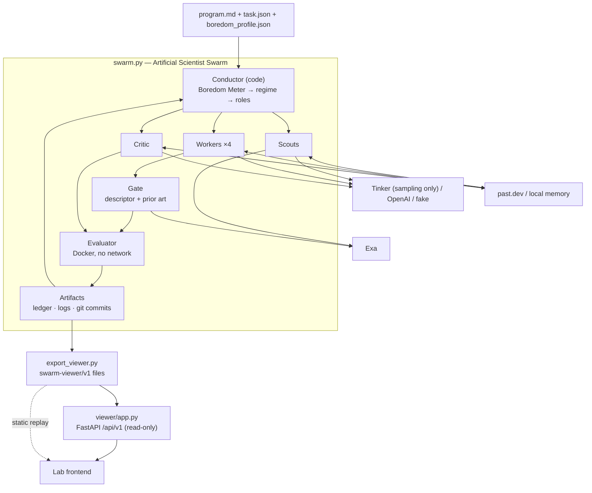

# Architecture

Caffeinated runs **Artificial Scientist Swarms**: groups of LLM agents that
propose, test and verify research changes against a frozen evaluator, steered
by a deterministic Boredom Meter. Everything runs on CPU; no model is trained.

## Layers

| Layer | Code | Responsibility |
|---|---|---|
| Protocol | `program.md`, `testcases/<task>/task.json`, `boredom_profile.json` | human-edited rules, editable file, vocabulary, thresholds |
| Orchestration | `swarm.py` | rounds, roles, proposals, commits, critic — see [orchestration](orchestration.md) |
| Boredom | `boredom_meter/meter.py`, `boredom.py` | B, components, regimes, gate, suggestions — see [boredom](boredom.md) |
| Research | `research.py` | Exa search/contents, prior-art checks, cache, budget |
| Memory | `memory.py` | past.dev or local store, writes and recalls with authorship |
| LLM | `llm.py`, `prompts/` | prompt rendering, Tinker/OpenAI/fake clients, call log |
| Evaluation | `testcases/sandbox.py`, `testcases/*/evaluate.py` | candidate runs in a network-less container; the host computes the loss |
| Viewer data | `export_viewer.py` | normalized events, UUIDs, ticks, entities, keyframes |
| API | `viewer/app.py` | read-only `/api/v1` over the exports, SSE stream |

## Trust boundaries

- **Candidates are untrusted.** The host never imports candidate code. Only
  the editable file and public inputs enter the container; hidden answers and
  secrets stay on the host.
- **The meter cannot be gamed by a model.** B is recomputed from the ledger
  and profile; responses carry `ledger_sha256` / `profile_sha256`.
- **Claims are checked twice.** A new best must survive a second-seed critic
  run; SNAP/BREAKOUT ideas must cite a source.
- **The viewer side is read-only.** The API reads exported files, holds no
  credentials and cannot start runs.

## Data model

Raw run files stay the source of truth. `export_viewer.py` derives the
`swarm-viewer/v1` model defined in `docs/swarm-viewer-api.md` (on `main`,
[PR #9](https://github.com/arii/caffeinated/pull/9)):

- deterministic UUIDv5 ids for the run, agents and events;
- a gap-free `tick` (ordered by round, phase, timestamp) for pause and scrub;
  missing source timestamps stay `null`;
- normalized events (`round.started`, `boredom.measured`, `hypothesis.proposed`,
  `gate.checked`, `experiment.finished`, `verdict.issued`, `discovery.made`, …);
- entities (questions, observations, hypotheses, experiments, rewards, diary,
  memory, sources, llm_calls, discoveries); prompts and reasoning live only in
  `llm_calls`;
- keyframes plus a pure reducer, so `world_at(tick)` is reproducible.

The static export layout mirrors the API, so the frontend can switch between
files and HTTP without code changes.

## Vendors

| Vendor | Role | Notes |
|---|---|---|
| Tinker | LLM researcher (Kimi K3.1 Pro) | sampling only, no fine-tuning |
| Exa | scouting and prior-art checks | outside the meter's scoring path |
| past.dev | shared memory across agents and runs | `local` fallback for offline runs |
| Hugging Face | BixBench data (one-time `prepare.py`) | |
| OpenAI | optional LLM backend | |

## Domains

- **Benchmarks:** `hadamard19`, `bixbench_mini`, `playworld_mini`, which are small
  CPU-sized versions of the hackathon's records to beat (see
  [`testcases/README.md`](../testcases/README.md)).
- **Ig Nobel:** a community of agents running reproducible studies with
  replication and separate LAUGH/THINK judging (`ignobel/` on `main`). It uses
  the same Boredom Meter with its own profile.
