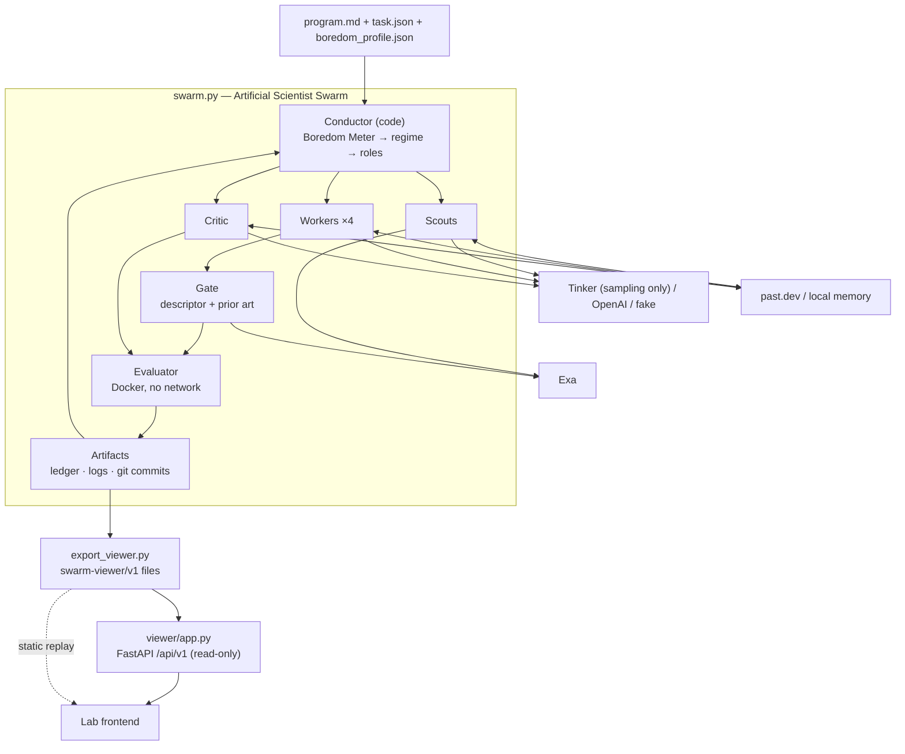

# Architecture

Caffeinated runs **Artificial Scientist Swarms**: groups of LLM agents that
propose, test and verify research changes against a frozen evaluator, steered
by a deterministic Boredom Meter. Everything runs on CPU; no model is trained.

## Layers

| Layer | Code | Responsibility |
|---|---|---|
| Protocol | `program.md`, `testcases/<task>/task.json`, `boredom_profile.json` | human-edited rules, editable file, vocabulary, thresholds |
| Orchestration | `swarm.py` | rounds, roles, proposals, commits, critic — see [orchestration](orchestration.md) |
| Boredom | `boredom_meter/meter.py`, `boredom.py` | B, components, regimes, gate, suggestions — see [boredom](boredom.md) |
| Research | `research.py` | Exa search/contents, prior-art checks, cache, budget |
| Memory | `memory.py` | past.dev or local store, writes and recalls with authorship |
| LLM | `llm.py`, `prompts/` | prompt rendering, Tinker/OpenAI/fake clients, call log |
| Evaluation | `testcases/sandbox.py`, `testcases/*/evaluate.py`, `held_out.py` | candidates run in a network-less container; the host grades dev feedback and the one-shot held-out test |
| Viewer data | `export_viewer.py` | normalized events, UUIDs, ticks, entities, keyframes, held-out result in the manifest |
| API | `viewer/app.py` | read-only `/api/v1` over the exports, SSE stream |

## Trust boundaries

- **Candidates are untrusted.** The host never imports candidate code. Only
  the editable file and public inputs enter the container; hidden answers and
  secrets stay on the host.
- **Held-out scores are not feedback.** BixBench and Playworld rounds use
  development splits; `held_out.py` grades baseline and best accepted commits
  once at run completion. BixBench also disables task research and rejects
  answer-valued source literals using the host-side gold key.
- **The meter cannot be gamed by a model.** B is recomputed from the ledger
  and profile; responses carry `ledger_sha256` / `profile_sha256`.
- **Claims are checked twice.** A new best must survive evaluator confirmation
  and an LLM critic verdict; `contradicted` vetoes acceptance. Deterministic
  tasks reuse the first score, so confirmation is not an independent replicate.
  SNAP/BREAKOUT ideas must cite a source.
- **Ig Nobel optimizes for interesting findings.** Confirmed studies are judged
  in-loop by two committee judges using only a host-written abstract and
  optional Exa prior-work evidence; an established or textbook result is
  capped at THINK 3, while targeting a group scores zero. The judges use
  gpt-oss-120b and Qwen3.5; neither is the Kimi generator model.
- **The viewer side is read-only.** The API reads exported files, holds no
  credentials and cannot start runs.

## Data model

Raw run files stay the source of truth. `export_viewer.py` derives the
`swarm-viewer/v1` model defined in `docs/swarm-viewer-api.md` (on `main`,
[PR #9](https://github.com/arii/caffeinated/pull/9)):

- deterministic UUIDv5 ids for the run, agents and events;
- a gap-free `tick` (ordered by round, phase, timestamp) for pause and scrub;
  missing source timestamps stay `null`;
- normalized events (`round.started`, `boredom.measured`, `hypothesis.proposed`,
  `gate.checked`, `experiment.finished`, `verdict.issued`, `discovery.made`, …);
- entities (questions, observations, hypotheses, experiments, rewards, diary,
  memory, sources, llm_calls, discoveries); prompts and reasoning live only in
  `llm_calls`;
- keyframes plus a pure reducer, so `world_at(tick)` is reproducible.

The static export layout mirrors the API, so the frontend can switch between
files and HTTP without code changes.

For held-out tasks, the run writes `held_out_test.json`; the parsed object is
exposed as `manifest.held_out_test`. It is manifest-only, so publishing it does
not alter the event stream.

## Vendors

| Vendor | Role | Notes |
|---|---|---|
| Tinker | Kimi K3.1 Pro generator; Ig Nobel judges (gpt-oss-120b, Qwen3.5) | sampling only; judges are independent of the Kimi generator |
| Exa | scouting and prior-art checks | outside the meter's scoring path |
| past.dev | shared memory across agents and runs | `local` fallback for offline runs |
| Hugging Face | BixBench data (one-time `prepare.py`) | |
| OpenAI | optional LLM backend | |

## How we use Exa and past.dev

### Exa and citation provenance

`research.py` owns Exa requests. `swarm.py::run_scouts` uses it for scout paper
and code searches; `swarm.py::worker_search` searches around the task's suggested
method cells for source and dataset discovery; `research.py::run_prior_art`
supports prior-art checks. `research.py::write_query_results` records each
query and its returned sources in `research_log.jsonl`: query IDs are `Q<n>`,
and result IDs are `S<n>` with a `query_id` linking each result to its query.

`swarm.py::validate_proposal` accepts source IDs in the `S<n>` form, and
`export_viewer.py` builds Lab source entities and research observations from
the `source` records in `research_log.jsonl`. This makes each Exa source shown
in a swarm research trace traceable to its result record and originating
query. For Ig Nobel, `testcases/ignobel/evaluate.py::research_sources` and
`check_citations` validate an `S<n>` against the current run's research log.
The separate citations shown on Ig Nobel study cards may also be logged URLs,
vetted entries from `testcases/ignobel/sources.json`, or Crossref-verified
DOIs, so not every study-card citation is an Exa result ID.

For committee novelty context, `testcases/ignobel/committee.py::_exa_search`
searches the host-written headline once when there is no cached result, Exa is
enabled and `EXA_API_KEY` is present. It requests and retains up to five
results. `get_prior_work` caches them under `.cache/committee`, and
`score_study` passes the results to the judges as data.

`testcases/bixbench_mini/task.json` sets `"research": "off"`;
`swarm.py::resolve_run_args` honors that setting by forcing Exa and keyless
literature search off for the task.

### past.dev memory

`memory.py::write` sends memory writes to past.dev's ingest endpoint, and
`memory.py::_recall` retrieves memories. `swarm.py` calls these through
`write_memory_item` and `recall_memory`. `memory.py::audience_for_arm` assigns
each arm its own `arm-<x>` audience (and corresponding `swarm-arm-<x>`
identity). Run scope tags include the arm and run ID, and include the task
when it is set. Recall filtering drops foreign-task and other out-of-scope
records; it deliberately reuses same-arm, same-task lessons, verdicts and
failed results across runs, while claims, leads, assignments and kept results
remain run-scoped.

The selectable backends are `pastdev`, `local` and `none`. If past.dev is
explicitly selected without `PAST_API_KEY` (or an arm-specific key),
`memory.py::write` and `memory.py::_recall` raise an error rather than silently
falling back. If the backend is left unspecified, `selected_backend` chooses
local memory when no past.dev key is available.

The `out-ignobel` run artifact records 15 requested rounds, Tinker/Kimi,
Exa enabled, past.dev memory and a stopped run status. `scripts/run_cost.py`
reports 116 Kimi calls, 498,397 prompt tokens and 137,636 completion tokens.
For Exa it reports 119 calls, $0.761 total and 414 ms p50 latency. For past.dev
it reports 157 recalls (577 ms p50) and 123 writes (340 ms p50); the API did not
report a price, so cost is `null`. The past.dev-versus-local-memory accuracy
comparison has not been run yet; it is blocked on Tinker credit.

## Domains

- **Benchmarks:** `hadamard19`, `bixbench_mini`, `playworld_mini`, which are small
  CPU-sized versions of the hackathon's records to beat (see
  [`testcases/README.md`](../testcases/README.md)).
- **Ig Nobel:** the swarm task `swarm.py --task ignobel`: expert labs
  pre-register one Spearman test per real public dataset, the host grades
  significance and split-half consistency, then a two-judge LAUGH/THINK
  committee scores each confirmed study during evaluation. Its score contributes
  `0.25 + 0.75 * committee_score` to swarm reward (zero for targeting a group);
  `score_run.py` reports the cached verdicts after the run. It uses the same
  Boredom Meter with its own profile (`testcases/ignobel/boredom_profile.json`).
